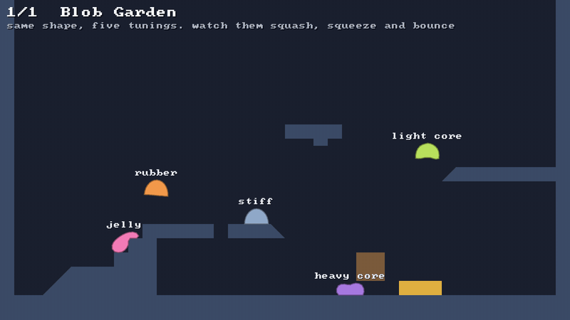
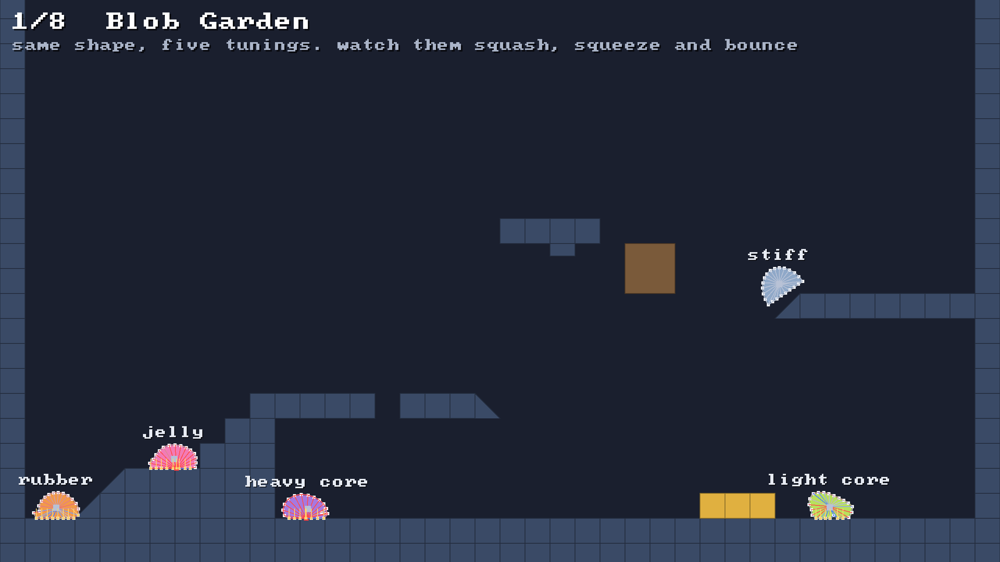
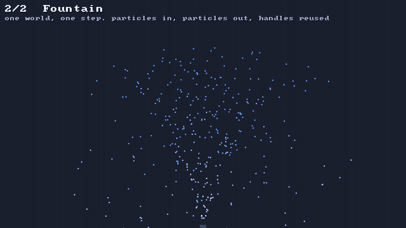
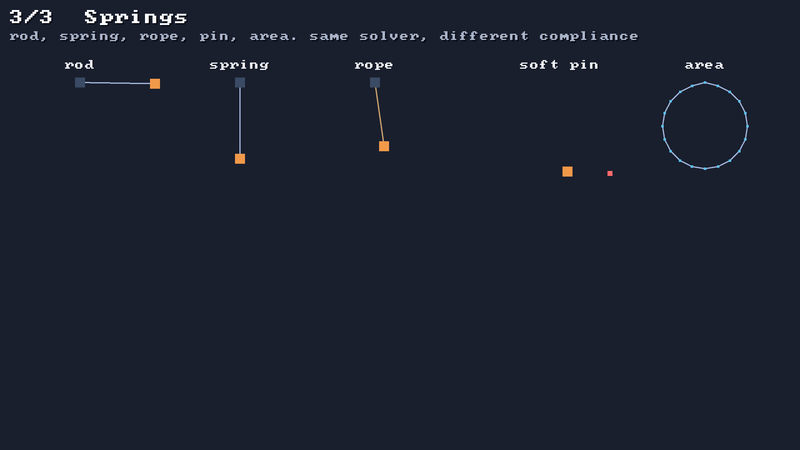
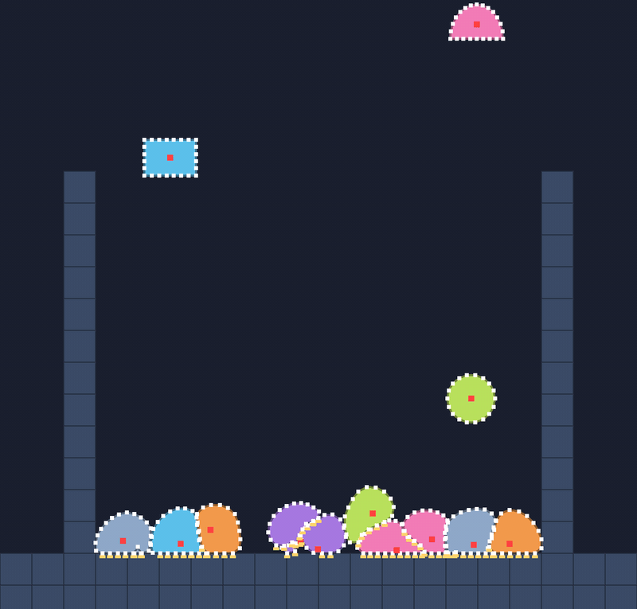
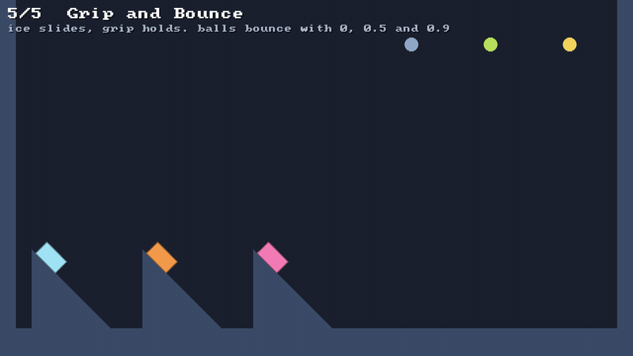
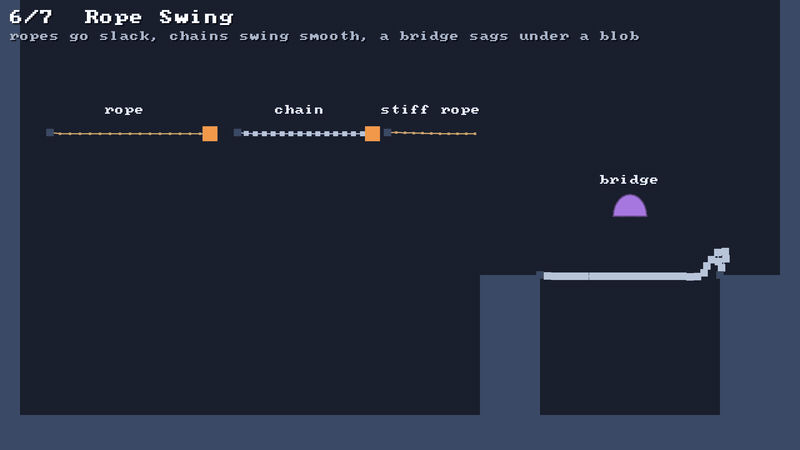
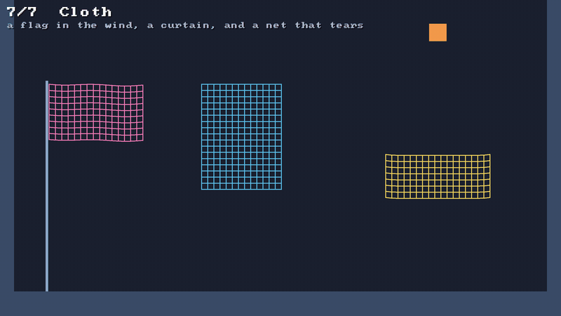
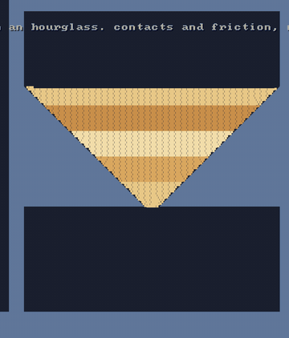
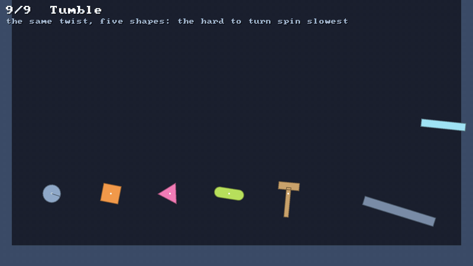

<p align="center">
  
</p>

<p align="center">
  <b>a small, fast 2D physics engine for <a href="https://github.com/inemtsev/klyph">klyph</a></b> 🟢<br>
  <a href="https://github.com/pererikbergman/klyph-physics/actions/workflows/ci.yml"></a>
</p>

---

## ⚡ 10-second version

- 🍮 **soft bodies**, 🪢 **ropes**, 🧣 **cloth** and ⏳ **sand** today. 📦 rigid bodies and 🔩 joints are on the way
- 🧮 all of it in **one XPBD solver**, so a blob can push a crate and a crate can squash a blob
- 🧩 a **side module**: the engine itself depends on **nothing**, not even klyph
- 🎮 a **sandbox** that shows every feature, one scene at a time
- 🧪 **209 tests**, all green

## ▶️ Run it

```
git clone https://github.com/pererikbergman/klyph-physics
cd klyph-physics
./gradlew :demo:run
```

You need JDK 17+. On macOS and Windows the klyph plugin downloads SDL3 for you. On Linux, install
SDL3 3.4+ yourself.

| key | does |
|---|---|
| `1`–`9` / `[` `]` | pick a scene |
| `R` | reset the scene |
| `Space` | pause |
| `.` | one step at a time 🐢 |
| `S` | slow motion, ¼ speed |
| `F1` | show what the physics sees 👀: bodies, then constraints, then contacts, then off |
| `B` | show the broadphase's grid |
| `F3` | klyph's frame stats |
| 🖱️ left mouse | grab something and drag it 🖐️ |
| 🖱️ right mouse | add the scene's own thing: a blob, a ball, a spring, a burst of grains, a shape |
| `Esc` | quit |

---

## 🎬 Scenes

### 1 · 🍮 Blob Garden

**Same shape, five tunings.** Jelly, rubber, stiff, a heavy core and a light core hop around
ramps, stairs, a low ceiling, bounce pads 🟨 and a crusher 🟫. Watch how differently they squash.



☝️ That's `F1` three times. The white dots are the particles and the red dot the heavy core; the
spokes go red where they stretch and blue where they squeeze; the yellow lines are particles standing
on something, pointing the way they were pushed. Once shows just the dots, twice adds the
constraints, a fourth time turns it off. [🔍 More](docs/explained/debug-views.md)

### 2 · ⛲ Fountain

**One world, one step.** 360 particles a second shoot up and fall out of sight. Each one that leaves
hands its handle to a new one, so the world's memory stops growing. ♻️



### 3 · 🔗 Springs

**Every kind of constraint.** A rigid rod, a soft spring, a rope that goes slack, a weight chasing a
soft pin, and a water balloon held round by its area. Below them, three ropes held at one end:
stiff bends stick out, soft ones droop, none hang. Same solver, different compliance.



### 4 · 🧺 Blob Pile

**Thirty bodies through a funnel.** Domes, balls and boxes pour in one after another, slide down
an icy funnel and pile up in a bin. None of them goes through another. 🙅



### 5 · 🧽 Grip and Bounce

**Friction and restitution, side by side.** Three boxes set down on three ramps: ice slides off,
the default slides, grip holds. Three balls dropped from one height bounce back with 0, 0.5 and 0.9.



### 6 · 🪢 Rope Swing

**Ropes and chains.** A rope goes slack, a chain swings smooth, a stiff rope sticks out, and a chain
bridge sags under a blob.



### 7 · 🧣 Cloth

**Sheets that hang, flap and tear.** A flag in gusts of wind, a curtain, and a heavy ball that tears
through a net.



### 8 · ⏳ Sand

**3 000 grains in an hourglass.** Each one a round particle on its own: no bodies, no constraints,
just contacts and grip. They pour through the neck and heap up at the slope their friction holds,
at 60 FPS and then some. 🏖️



### 9 · 📦 Tumble

**Bodies that turn.** A circle, a box, a triangle, a capsule and a hammer of two boxes are tossed up
with the same twist. They fly the same arc, because spin doesn't change a fall, but the ones that
are hard to turn spin slowest. A kinematic paddle goes round a circle exactly where it's told, and a
static bar never moves.



Every scene's step, timed without a window on the release build:
`SANDBOX_BENCH=600 ./gradlew :demo:runRelease`. Sand, the heaviest, takes about 6 ms a step.

More scenes land with every milestone. 🚀

---

## 🧠 How it works

Every part of the engine has a short explainer page: one picture, three bullets, the knobs, and
what breaks it. 👉 [**docs/explained**](docs/explained/README.md)

## 🧩 What's in here

| folder | what |
|---|---|
| `klyph-physics/` | 🧠 the engine. pure Kotlin, **zero dependencies** |
| `klyph-physics-bridge/` | 🔌 the klyph glue: draw what the physics sees |
| `demo/` | 🎮 the sandbox |
| `scripts/capture.sh` | 📸 records a scene into the GIFs you see here |
| `docs/` | 📚 [the design](docs/specs/2026-11-10-klyph-physics-design.md) and the explainers |

```
./gradlew allTests                                  # the engine's tests
./gradlew :demo:macosArm64Test                      # the sandbox's tests (a 10-minute garden run included)
scripts/capture.sh 1 blob-garden --from 1 --to 7    # re-record the GIF above
SANDBOX_BENCH=600 ./gradlew :demo:runRelease        # time every scene's step
```

## 🚧 Status

Milestones 1 and 2 of 5 are done: the sandbox, and the particle world with its soft bodies, ropes,
cloth and sand. Under way: 📦 rigid bodies, which turn already. The plan is in [the design](docs/specs/2026-11-10-klyph-physics-design.md), and
the work is tracked in the [milestones](../../milestones).

It grew out of the slime in [slimy-the-blob](https://github.com/pererikbergman/slimy-the-blob). 🟢

## 📜 Licence

Apache-2.0, the same as klyph.
