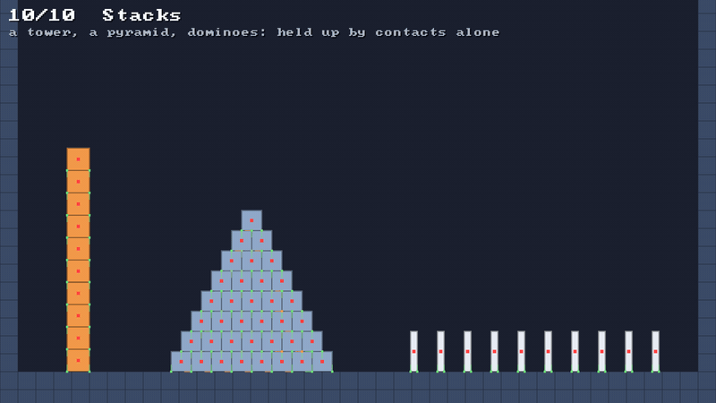
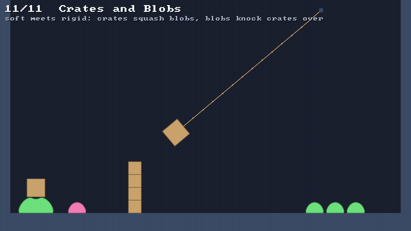
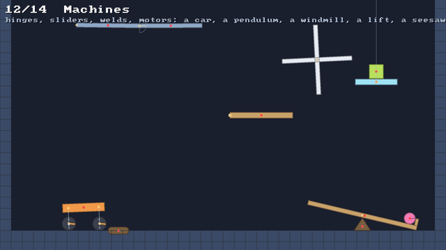
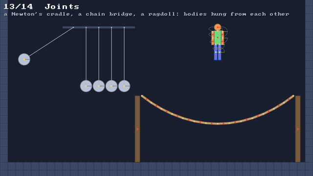
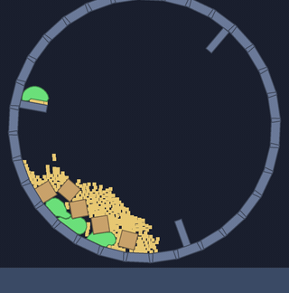
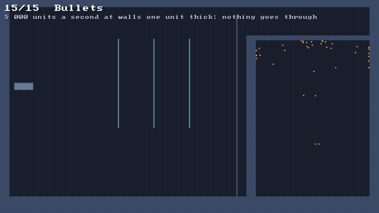
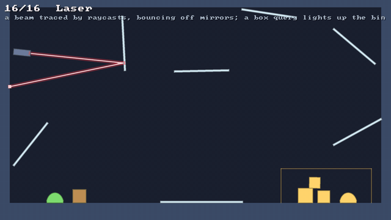

<p align="center">
  
</p>

<p align="center">
  <b>a small, fast 2D physics engine for <a href="https://github.com/inemtsev/klyph">klyph</a></b> 🟢<br>
  <a href="https://github.com/pererikbergman/klyph-physics/actions/workflows/ci.yml"></a>
</p>

---

## ⚡ 10-second version

- 🍮 **soft bodies**, 🪢 **ropes**, 🧣 **cloth**, ⏳ **sand**, 📦 **rigid bodies that stack** and 🔩 **joints with motors**, all pushing each other
- 🧮 all of it in **one XPBD solver**, so a blob can push a crate and a crate can squash a blob
- 🧩 a **side module**: the engine itself depends on **nothing**, not even klyph
- 🎮 a **sandbox** that shows every feature, one scene at a time
- 🧪 **308 tests**, all green

## ▶️ Run it

```
git clone https://github.com/pererikbergman/klyph-physics
cd klyph-physics
./gradlew :demo:run
```

You need JDK 17+. On macOS and Windows the klyph plugin downloads SDL3 for you. On Linux, install
SDL3 3.4+ yourself.

| key | does |
|---|---|
| `1`–`9`, `0` / `←` `→` | pick a scene (`[` `]` too, on a US keyboard) |
| `R` | reset the scene |
| `Space` | pause |
| `.` | one step at a time 🐢 |
| `S` | slow motion, ¼ speed |
| `F1` | show what the physics sees 👀: bodies, then constraints, then contacts, then off |
| `B` | show the broadphase's grid |
| `F3` | klyph's frame stats |
| 🖱️ left mouse | grab something and drag it 🖐️ |
| 🖱️ right mouse | add the scene's own thing: a blob, a ball, a spring, a burst of grains, a shape |
| `Esc` | quit |

---

## 🎬 Scenes

### 1 · 🍮 Blob Garden

**Same shape, five tunings.** Jelly, rubber, stiff, a heavy core and a light core hop around
ramps, stairs, a low ceiling, bounce pads 🟨 and a crusher 🟫. Watch how differently they squash.


☝️ That's `F1` three times. The white dots are the particles and the red dot the heavy core; the
spokes go red where they stretch and blue where they squeeze; the yellow lines are particles standing
on something, pointing the way they were pushed. Once shows just the dots, twice adds the
constraints, a fourth time turns it off. [🔍 More](docs/explained/debug-views.md)

### 2 · ⛲ Fountain

**One world, one step.** 360 particles a second shoot up and fall out of sight. Each one that leaves
hands its handle to a new one, so the world's memory stops growing. ♻️


### 3 · 🔗 Springs

**Every kind of constraint.** A rigid rod, a soft spring, a rope that goes slack, a weight chasing a
soft pin, and a water balloon held round by its area. Below them, three ropes held at one end:
stiff bends stick out, soft ones droop, none hang. Same solver, different compliance.


### 4 · 🧺 Blob Pile

**Thirty bodies through a funnel.** Domes, balls and boxes pour in one after another, slide down
an icy funnel and pile up in a bin. None of them goes through another. 🙅


### 5 · 🧽 Grip and Bounce

**Friction and restitution, side by side.** Three boxes set down on three ramps: ice slides off,
the default slides, grip holds. Three balls dropped from one height bounce back with 0, 0.5 and 0.9.


### 6 · 🪢 Rope Swing

**Ropes and chains.** A rope goes slack, a chain swings smooth, a stiff rope sticks out, and a chain
bridge sags under a blob.


### 7 · 🧣 Cloth

**Sheets that hang, flap and tear.** A flag in gusts of wind, a curtain, and a heavy ball that tears
through a net.


### 8 · ⏳ Sand

**3 000 grains in an hourglass.** Each one a round particle on its own: no bodies, no constraints,
just contacts and grip. They pour through the neck and heap up at the slope their friction holds,
at 60 FPS and then some. 🏖️


### 9 · 📦 Tumble

**Bodies that turn.** A circle, a box, a triangle, a capsule and a hammer of two boxes are tossed up
with the same twist. They fly the same arc, because spin doesn't change a fall, but the ones that
are hard to turn spin slowest. A kinematic paddle goes round a circle exactly where it's told, and a
static bar never moves. Right click to drop more in: the paddle knocks them about.


### 0 · 🧱 Stacks

**Held up by contacts alone.** A tower of ten boxes and a pyramid of eight rows stand still, while
a row of dominoes topples one after another. Two contact points under each box keep it flat, and
friction keeps it from sliding off the one below. Once still, they fall asleep, fade and cost
nothing, until a wrecking ball swings in, wakes the tower and knocks its top off. Right click to
drop a box on them. 🎯 [😴 Sleeping](docs/explained/sleeping.md)



### 11 · 🤝 Crates and Blobs

**Soft meets rigid.** A crate rests on a big blob and squashes it a little. A blob is thrown at a
tower of crates and knocks it down. A heavy crate on a rope swings through three blobs and sweeps
them away. A crate bounces on a trampoline of round particles. Each side moves the other. The 11th scene, so press `→` to reach it. 💥



### 12 · 🔩 Machines

**Bodies joined the way machines are.** A double pendulum swings wildly on two hinges. A car drives
back and forth over a bump on motorised wheels, each on a sprung strut. A welded shelf bears three
crates and breaks at the fourth. A windmill turns on its motor. A lift on a slider carries a crate
down and up, and a crate dropped on a seesaw throws a ball into the air. Press `→` to reach it, and `F1` twice to see the joints. 🏗️



### 13 · ⚖️ Joints

**Bodies hung from each other.** A Newton's cradle: five balls on rods, the first let go, its swing
passed through the middle three to the last. A chain bridge of fourteen hinged planks, and a ragdoll
of ten bodies dropped on it, its elbows and knees bending only one way. Right click for another
ragdoll. 🤸



### 14 · 🥁 Drum

**Everything in one turning drum.** Blobs, crates and 240 grains of sand, carried up the side of a
kinematic drum by its paddles until they tumble back down, pushing on each other all the way. Right
click to drop a crate in. 🌀



### 15 · 🚀 Bullets

**Too fast to see, stopped by too thin to see.** A gun fires bullets at 5 000 units a second, 20
units a substep, at three hanging panes and a plate one unit thick, and none goes through. On the
right, sparks shoot up at a ledge half a tile thick and drop back into their bin. Right click to fire
at the mouse. 🎯 [🚀 Fast things and tunnelling](docs/explained/tunnelling.md)



### 16 · 🔦 Laser

**A beam traced by raycasts.** A laser hits a mirror spinning on a motor, which throws it round the
room, off mirrors on the walls, the ceiling, the floor and one swinging on a hinge. It ends on the first
thing that isn't a mirror, which lights up. Each bounce is a new ray from where the last one hit. In the bin on the right a box query finds
what's inside, and it glows. Right click to drop a crate or a blob. 🎯 [🔦 Raycasts and queries](docs/explained/queries.md)



Every scene's step, timed without a window on the release build:
`SANDBOX_BENCH=600 ./gradlew :demo:runRelease`. Sand, the heaviest, takes about 6 ms a step.

More scenes land with every milestone. 🚀

---

## 🧠 How it works

Every part of the engine has a short explainer page: one picture, three bullets, the knobs, and
what breaks it. 👉 [**docs/explained**](docs/explained/README.md)

## 🧩 What's in here

| folder | what |
|---|---|
| `klyph-physics/` | 🧠 the engine. pure Kotlin, **zero dependencies** |
| `klyph-physics-bridge/` | 🔌 the klyph glue: draw what the physics sees |
| `demo/` | 🎮 the sandbox |
| `scripts/capture.sh` | 📸 records a scene into the GIFs you see here |
| `docs/` | 📚 [the design](docs/specs/2026-11-10-klyph-physics-design.md) and the explainers |

```
./gradlew allTests                                  # the engine's tests
./gradlew :demo:macosArm64Test                      # the sandbox's tests (a 10-minute garden run included)
scripts/capture.sh 1 blob-garden --from 1 --to 7    # re-record the GIF above
SANDBOX_BENCH=600 ./gradlew :demo:runRelease        # time every scene's step
```

## 🚧 Status

Milestones 1 and 2 of 5 are done: the sandbox, and the particle world with its soft bodies, ropes,
cloth and sand. Under way: 📦 rigid bodies, which turn, collide, stack, slide, push and are pushed by blobs, and join up into machines already. The plan is in [the design](docs/specs/2026-11-10-klyph-physics-design.md), and
the work is tracked in the [milestones](../../milestones).

It grew out of the slime in [slimy-the-blob](https://github.com/pererikbergman/slimy-the-blob). 🟢

## 📜 Licence

Apache-2.0, the same as klyph.
