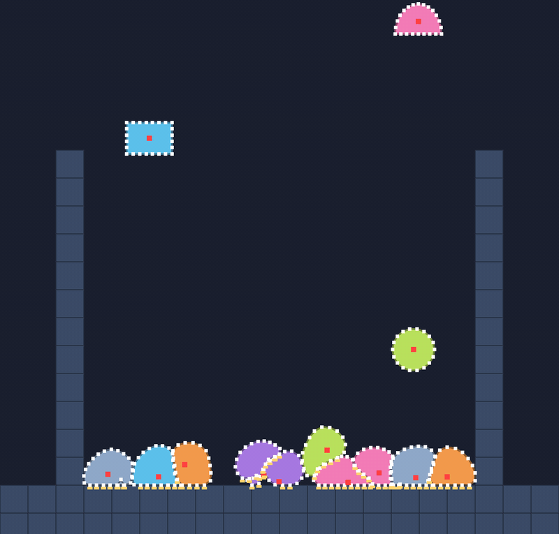

# 💥 Bodies hitting bodies

⚡ **A dot that ends up inside another blob gets shoved back out through the nearest bit of skin, and the skin gets shoved back.**



## 🧠 How it works

- 👉 once a step, the [🗂️ broadphase](broadphase.md) finds which bodies **might** touch. only those get checked
- 👉 a particle **inside** another body's outline goes out to the **nearest edge**. both sides move, the light one more 🪶🪨
- 👉 grains of sand are round particles that push each other apart **by their radii** ⏳

<details>
<summary>🤓 the details</summary>

**It's in every pass.** One substep's pass now goes:

```
🧮 constraints.solve      pull everything toward rest
💥 bodies collide         push bodies out of each other   ← new
🧱 solids collide         walls get the last word
```

**Particle vs. outline** 🍮: for particle `p` and the nearest edge `a → b`, with the closest point
`t` of the way along it:

```kotlin
val w = wp + (1 - t)² · wa + t² · wb        // who's light, who's heavy
val push = depth / w
p += wp · push · n                          // the particle goes out
a -= (1 - t) · wa · push · n                // the edge goes back, the nearer end more
b -= t · wb · push · n
```

A heavy core barely moves. A skin dot of mass 1 against another skin dot: they meet halfway. 🤝

**Inside or outside?** The same winding test as [🌀 Outline](outline.md), so a folded blob is still
solid to everyone else.

**The core stays in** 🥚: every pass, a body whose core has got out of its own skin pulls the two
back together. A very soft jelly squashed in a corner by another blob used to lose its core for half
a second. The core is the goo inside, so now it can't leave.

**A thin skin** 🧴: a dot keeps 0.5 units from other bodies. Two blobs pressed onto the same floor
would otherwise line their dots up exactly on each other's edges, where "inside" is a coin toss.

**Grains** ⏳: `particles.add(x, y, radius = 2f, collides = true)`. Two grains closer than
`ra + rb` are pushed apart along the line between them, by inverse mass. They also stay out of soft
bodies. A particle that doesn't collide (the default) only meets the solids, like the fountain's.

**Standing on each other** 🦶: a push that lifts a particle counts as a floor in
[🦶 Contacts](contacts.md), so a blob on top of another can still jump. No tags: only solids have those.

**Self-collision** 🌀: off by default. `softBodies.setSelfCollision(body, true)` keeps every skin dot
half an edge away from the body's own other edges, for things that fold.

</details>

## 🎛️ The knobs

| knob | default | turn it up 🔼 | turn it down 🔽 |
|---|---|---|---|
| `collides` on `particles.add` | `false` | a grain: hits bodies and other grains | a ghost: only hits solids 👻 |
| `radius` | `0` | a bigger grain, a wider gap | a point |
| `setSelfCollision(body, on)` | off | a folding skin can't pass through itself | cheaper: no check of every dot against every edge |
| `PhysicsConfig.cellSize` | `32` | for big bodies | for small ones. about one body wide is best |

## 💥 Gotchas

- 💥 **Without grip, stacks slide apart.** Drop a blob on another with `Material.ICE` and it lands,
  wobbles and slides off the side. It doesn't sink in. With [🧽 friction](friction.md) it stays on top.
- 💥 **The core lost its skin.** A very soft jelly pinned in a corner, with another blob landing on
  it, had its skin pushed away while the heavy core stayed put on the floor. Fixed by keeping every
  core inside its own skin.
- 💥 **Dots exactly on an edge.** Two bodies on one floor slide their dots onto each other's edges,
  where there's no "in" or "out". The 0.5-unit skin and the edge's normal sort it out.
- 💥 **A pile gives a little.** Deep in a pile of 20, a dot can sit up to a unit inside its neighbour
  while the passes catch up. More iterations make it tighter.

## 🧪 Try it

`./gradlew :demo:run`, press `4` for **Blob Pile**, then `F1`. The yellow marks are dots standing
on something: the floor, or a body underneath. `R` drops them all again.

📸 `scripts/capture.sh 4 bodies --from 2.5 --to 6 --details --clean --crop 0.25,0.15,0.5,0.85`
