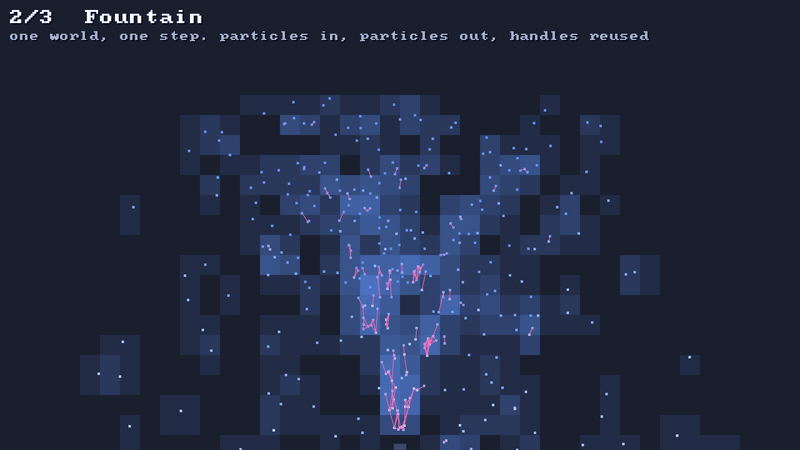

# 🗂️ Broadphase: who might touch whom

⚡ **Don't check every particle against every other particle. File them by where they are, and only compare neighbours.**



## 🧠 How it works

- 👉 cut space into **cells**. file every box under each cell it covers 🗂️
- 👉 only boxes filed **under the same cell** get compared. 10 000 particles: a few tens of thousands of checks, not 50 million 🤯
- 👉 a box is grown by **how far it moves this step**, so one build per step finds what a fast thing will hit 🏎️

<details>
<summary>🤓 the details</summary>

```kotlin
val bp = Broadphase(cellSize = 16f)

// once per step:
bp.clear()
for (p in particles) bp.addMoving(p, x, y, dx, dy, radius)   // dx, dy: where it'll be after the step
bp.build()

for (i in 0 until bp.pairCount) {
    val a = bp.pairA(i)        // 👈 the ids you gave add(), the earlier one first
    val b = bp.pairB(i)
    // narrowphase: do they really touch? 🔍
}
```

**No edge to the world** 🌍: a cell `(col, row)` goes into a bucket by a hash,
`(col · 73856093 xor row · 19349663) and mask`. The table has at least one bucket per filing,
so most buckets hold one cell. Two cells in one bucket? Each filing remembers its cell, so they're
told apart.

**A counting sort, no lists** 📊: count the filings per bucket, add the counts up to get where each
bucket starts, then write every filing into one flat array. Three passes, no objects, nothing to
garbage-collect. Each filing carries a copy of its box, so a bucket is read in one sweep. 🧹

**No pair twice** ☝️: two big boxes can share many cells. They only get compared in the
**top-left cell they share**: `max(col0a, col0b), max(row0a, row0b)`. Every other shared cell skips
them.

**Fast, in numbers** ⏱️: 10 000 particles in a 1000 × 1000 room, each moving 4 units a step:
19 000 filings, 7 000 pairs, built in **0.49 ms** on the JVM and **~0.65 ms** in a Kotlin/Native
release build on an M-series Mac. `BroadphaseSpeedTest` checks it (a looser 5 ms on shared CI runners).

**Checked against brute force** ✅: 20 random scenes, up to 450 boxes, some 80 units wide, some at
negative coordinates. Same pairs as comparing everything with everything, none twice.

</details>

## 🎛️ The knobs

| knob | default | turn it up 🔼 | turn it down 🔽 |
|---|---|---|---|
| `cellSize` | `16` | fewer filings, but more boxes per cell to compare | big boxes get filed under many cells 🐌 |
| motion in `addMoving` | the step's move | catches faster things, more pairs | misses what a fast thing will hit 👻 |

**Rule of thumb** 👍: a cell about the size of your typical box, plus a step's motion. In the demo,
a tile.

## 💥 Gotchas

- 💥 **A pair is a maybe, not a hit.** It only says the boxes overlap. Two diagonal round
  particles can be a pair and still not touch. That's the narrowphase's job.
- 💥 **One huge box is slow.** A box 100 cells wide is filed 10 000 times. Give giant things their
  own check.
- 💥 **Build after you've added everything**, and once per step. Pairs are from the last `build`.
- 💥 **Debug Kotlin/Native is ~12× slower.** 8 ms in a debug build, 0.65 ms in release. Measure in
  release.

## 🧪 Try it

`./gradlew :demo:run`, press `2` for **Fountain**, then `F1`. Blue cells are where particles are
filed: the brighter, the busier. Pink lines are the candidate pairs. 🩷

📸 `scripts/capture.sh 2 broadphase --from 2 --to 3.5 --details --clean`
