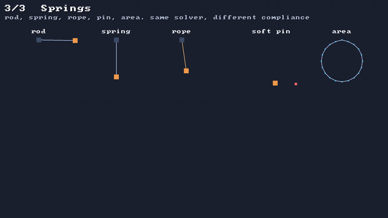

# 🔗 Constraints and compliance

⚡ **Five rules to hold particles together: keep this far apart, don't get farther than this, stay right here, keep this much room inside, don't fold here.**



## 🧠 How it works

- 👉 a **constraint** is a rule between particles, and an `Int` handle in the world's constraint store
- 👉 each one has a **compliance**: how far it gives per unit of force. `0` = rigid, bigger = softer
- 👉 every substep the world solves them all a few times, and **light particles move more** than heavy ones

<details>
<summary>🤓 the details</summary>

```kotlin
val cs = world.constraints

cs.distance(a, b)                        // 📏 keep a and b as far apart as they are now
cs.distance(a, b, compliance = 0.02f)    // 🌀 the same, but springy
cs.rope(a, b, rest = 80f)                // 🪢 never farther than 80. closer? slack
val pin = cs.pin(p)                      // 📌 stay where you are...
cs.movePin(pin, mouseX, mouseY)          //    ...or follow this point around
cs.area(ring)                            // 🎈 keep the area inside this ring of particles
cs.bend(a, b, c)                         // 🦴 keep the angle a → b → c turns at b
cs.bend(a, b, c, rest = 0.3f)            //    ...or hold it curled, 0.3 radians clockwise
```

| | kind | rule | goes slack? |
|---|---|---|---|
| 📏 | `distance` | length = rest | no, it pushes too |
| 🪢 | `rope` | length ≤ rest | yes, when shorter |
| 📌 | `pin` | particle = point | no |
| 🎈 | `area` | area = rest | no: squash it and it bulges |
| 🦴 | `bend` | angle at `b` = rest | no: fold it and it unfolds |

**Bending** 🦴: links alone make a chain, and a chain folds anywhere. A bend over every three
particles in a row makes it a rope that resists folding: stiff, and it sticks straight out from
where you hold it; soft, and it droops; none, and it hangs. The angle is how far the line **turns**
at `b`: `0` is straight on, positive is clockwise on screen, and it always turns back the short way.
Its compliance is per radian of **torque**, so the numbers are tiny: a 12-dot rope droops halfway
at `0.0000005`. Cloth uses the same rule along its rows and columns.

**The XPBD step** (same as in [🧮 XPBD](xpbd.md)), for every constraint:

```kotlin
val softness = compliance / (h * h)
val change = (-error - softness * lambda) / (sum of inverse masses + softness)
lambda += change                        // how hard it has pushed this substep
// move each particle by its inverse mass × change, along the rule's gradient
```

**How soft is soft?** 🧮 A weight on a spring settles where the spring's pull matches its weight:
`stretch = mass × gravity × compliance`. A 2-unit mass on the `0.02` spring sags
`2 × 1500 × 0.02 = 60` units. That's true at 2 substeps, 16 substeps, 1 iteration or 6: the
tests check all of them. ✅

**Removing a particle**: use `world.removeParticle(p)`, not `particles.remove(p)`. It removes every
constraint on `p` too, so the next particle to get `p`'s handle doesn't inherit its springs. 👻

</details>

## 🎛️ The knobs

| knob | default | turn it up 🔼 | turn it down 🔽 |
|---|---|---|---|
| `compliance` | `0` | softer, bouncier, sags more | stiffer. `0` is as rigid as the iterations allow |
| bend `compliance` | `0` | the rope droops, then hangs. try `0.0000001` to `0.000003` | sticks out straight |
| `rest` | the distance (or area) now | longer, or more room inside | shorter, or squeezed |
| particle `mass` | `1` | moves less when a rule pulls | moves more |
| `PhysicsConfig.iterations` | `6` | rigid rules get more rigid | cheaper |

## 💥 Gotchas

- 💥 **A reused handle inherits nothing, if you use `removeParticle`.** With `particles.remove`, the
  old constraints stay, and they'd grab the next particle that gets the handle.
- 💥 **Two static ends = nothing happens.** A rule between two particles that can't move is skipped.
- 💥 **A ring needs a direction, but either one works.** The area store remembers which way the ring
  runs when you add it.
- 💥 **A long rope is never quite rigid.** Each pass fixes every bend one after another, and a
  rigid rope of 12 dots still droops a little at the tip: about 14 units over 88 with the default
  6 iterations. More iterations or substeps straighten it.
- 💥 **A bend doesn't keep length.** It only turns. Put links between the dots too, or the rope
  stretches while it holds its angles.
- 💥 **Removing an area doesn't give its ring's room back.** Fine for a few, not for thousands
  added and removed every second.

## 🧪 Try it

`./gradlew :demo:run`, press `3` for **Springs**. Left to right: a rigid rod, a soft spring, a rope
thrown up so it goes slack and snaps, a weight on a soft pin chasing a point, and a water balloon
held round by its area. 🎈 Below them, three ropes held level at one end: stiff bends stick out,
soft ones droop, and the one with no bends hangs. 🦴

📸 `scripts/capture.sh 3 springs --from 0 --to 4 --clean`
