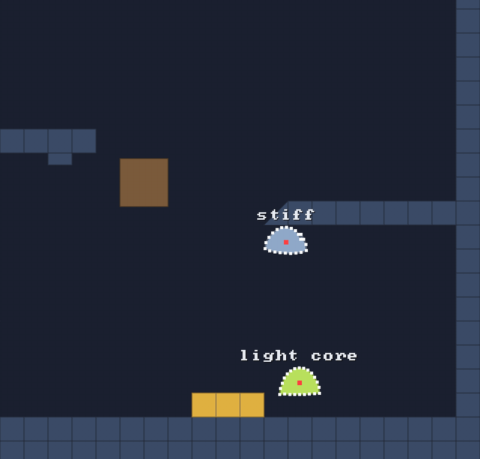

# 🦶 Contacts and tags

⚡ **After a step, the world can tell you which particles are standing on something, and what that something is.**



## 🧠 How it works

- 👉 when a solid pushes a particle **up** (any surface flatter than 60°), that particle is **on the floor**
- 👉 every solid has a **tag**: bit flags you choose, like `PAD = 1`. each particle collects the tags of everything it stood on
- 👉 it keeps **this step** and **the last step** apart, because "can I jump?" asks about *before* you left the ground

<details>
<summary>🤓 the details</summary>

`world.step` keeps the books for you. After a step, ask `world.events` about a particle, or
`world.softBodies` about a whole body:

```kotlin
world.step(dt)

world.events.isOnFloor(p)                  // particle p, the last step 🦶
world.events.wasOnFloor(p)                 // particle p, the step before
world.events.floorTags(p)                  // the tags it stood on, or-ed together

world.softBodies.isOnFloor(blob)           // any of its particles? 🦶
world.softBodies.touched(blob, PAD)        // stood on anything tagged PAD? 🟨
world.softBodies.floorContactCount(blob)   // how many feet down
```

The Blob Garden's bounce pads are just tiles with a tag:

```kotlin
const val PAD = 1
for (c in 28..30) grid.fill(c, 20, tag = PAD)
// ...
world.step(dt)
for (blob in blobs) if (bodies.touched(blob, PAD)) launch(blob, 0f, -BOUNCE_SPEED)   // 🚀
```

**What counts as a floor?** The push's normal must point up: `ny < -0.5` (y grows down). A flat
floor is `-1`, a 45° slope `-0.71` ✅, a wall `0` ❌, a ceiling `+1` ❌.

**No allocation**: two `IntArray`s next to the particles' positions, a bit for "this step", a bit
for "the step before", and the tags. A reused particle handle starts with nothing touched.

</details>

## 🎛️ The knobs

| knob | default | what it does |
|---|---|---|
| `tag` on `fill(...)` / `Solid.moving(...)` | `0` | your bit flags. or them together: `PAD or ICE` |
| floor threshold | `ny < -0.5` | steeper than 60° is a wall, not a floor. fixed for now |

## 💥 Gotchas

- 💥 **Ask after the step, not during it.** A touch in any substep of the step counts, so the answer
  is only complete once `step` returns. Ask before the next `step` for "was I on the floor?".
- 💥 **Only floors report tags.** Walls and ceilings push but don't record anything. A tagged wall
  stays silent.
- 💥 **Teleport and it still thinks it's on the ground** for one step: the last step's touches are
  still there until the next `step`.

## 🧪 Try it

`./gradlew :demo:run`, scene `1` **Blob Garden**, `F1` three times. The yellow lines are particles
on a floor this step, pointing the way they were pushed; cyan ones touched a wall or another body. Watch a blob hit the 🟨 pads.

📸 `scripts/capture.sh 1 contacts --from 7.2 --to 8.4 --view 3 --clean --slow --crop 0.5,0.15,0.5,0.85`
