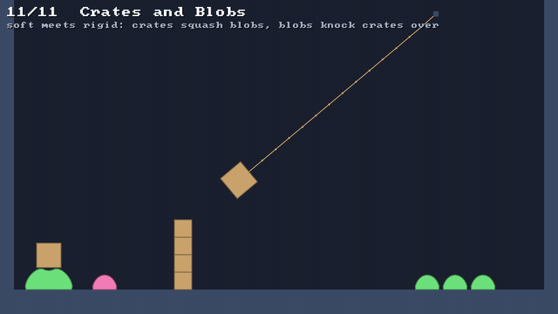

# 🤝 Soft meets rigid

⚡ **A particle that touches a rigid body pushes it back, at that point: crates squash blobs, blobs knock crates over.**



## 🧠 How it works

- 👉 every pass, each particle inside a rigid shape, or nearer than its radius, is pushed **out**, and the body is pushed **back** at the point it touched, so it moves and **turns** 🔄
- 👉 who moves how far is split by the particle's **mass** and how hard the body is to move **at that point**: easier at its far end, where it turns ⚖️
- 👉 a crate's sharp **corner** inside a blob's outline is pushed out too, so it can't slip between two of its particles 📐

<details>
<summary>🤓 the details</summary>

```kotlin
val world = PhysicsWorld()
val blob = world.softBody(dome, 320f, 448f)
val crate = world.rigidBody(Shape.box(28f, 28f), 320f, 400f)    // rests on the blob, squashing it
val grain = world.particles.add(100f, 300f, radius = 2f, collides = true)   // bounces off crates

val rope = world.rope(500f, 20f, 500f, 300f, segments = 14)
val tie = world.attach(rope.last, crate)                         // the rope's end, held to the crate
world.attachments.pointX(tie)                                    // where on the crate, in the world
world.attachments.remove(tie)                                    // let go
```

**One kind of contact, both sides moving.** A particle is a point with a radius, so it meets a rigid
shape exactly as a small circle would ([✂️ SAT](sat.md)): from inside the shape, out through the face
it's least deep behind; from outside, along the line to the nearest point. The push it takes is
split, XPBD style, by the particle's inverse mass `wₚ` and the body's inverse mass *at that point*
along the normal:

```
w_body = 1/m + (r × n)² / I       r: from the body's centre to the point
push   = depth / (wₚ + w_body)
```

The particle moves `wₚ·push` out, the body `push` back at `r`, moving and turning. A ball that hits a
crate square on its middle pushes it straight; one that hits it high turns it.

**Which particles?** Every particle of a soft body, and every particle made with `collides = true`:
the same ones that bump into each other. A plain rope or cloth passes through crates, as it passes
through blobs.

**Corners.** A box's flat face meets a blob's particles well, but a corner can poke in between
two of them. So each sharp corner of a rigid shape inside a soft body's outline is pushed out to the
outline's nearest edge, and that edge's two particles back, as for two blobs.

**Grip.** Each push is remembered with the point of the body it touched, in the body's own frame.
At the end of the substep, [🧽 friction](friction.md) measures how far the particle slid past that
point, which may have moved and turned, and holds it, or slows it, the body held back the same way.
A blob stands on a tilted crate made of rubber, and slides off one made of ice.

**Floors.** A push that lifts a particle counts as standing on a floor, as on the solids, so a blob
on a crate can jump ([🦶 contacts](contacts.md)).

**Attachments.** `attach(p, body)` holds a particle to the point of a body where it is now, the XPBD
way, softly if it has a compliance. The particle is dragged by the body and the body tugged by the
particle: a rope ties a crate to a hook. A particle doesn't bump into the body it's tied to.

</details>

## 🎛️ The knobs

| knob | default | turn it up 🔼 | turn it down 🔽 |
|---|---|---|---|
| `density` of the body | `0.05` | it squashes blobs flatter, and plows through them | blobs throw it about |
| `coreMass` of the blob | `34` in the demo | it holds crates up better, and hits them harder | squashed flat by a crate |
| `attach(…, compliance)` | `0` | the tie stretches like a spring | a firm hold |
| `Material.friction`, `staticFriction` | `0.4`, `0.6` | blobs grip crates, crates grip blobs | they slide off each other |

## 💥 Gotchas

- 💥 **A crate on a small blob rolls off.** A blob narrower than a crate is a ball under it, and it
  tips off as off a ball. Give it a blob wider than itself.
- 💥 **A soft box under a crate shears.** A blob made with `SoftBodies.box` gives sideways easily,
  like a jelly, so a crate on top rocks and slides off. A dome holds it.
- 💥 **A crate on a blob shivers.** The blob's particles tremble a little under the load, and the
  crate with them: a tenth of a unit, about. It doesn't creep.
- 💥 **No bounce.** Particles against rigid bodies are pushed out, not bounced. A ball meant to
  bounce off a crate stops on it.
- 💥 **A wrecking crate.** A crate as heavy as the blobs it hits stops among them, squashing them.
  The swinging one in the demo is five times as dense.

## 🧪 Try it

`./gradlew :demo:run`, press `→` until **Crates and Blobs**, the 11th scene: a crate sits on a big
blob, a blob knocks a tower down, a crate on a rope swings through three more. Right click to drop
blobs on the crates. Grab a crate and squash a blob with it. 🎯

📸 `scripts/capture.sh 11 coupling --from 0 --to 3 --clean`
