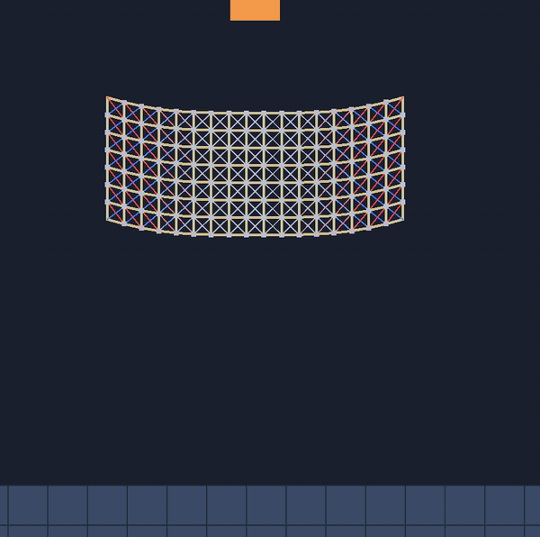
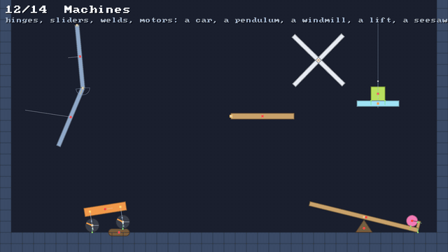

# 🔍 Debug views

⚡ **`F1` peels the world open a layer at a time: the particles, then every constraint coloured by how hard it's pulling, then every contact and which way it pushed.**



## 🧠 How it works

- 👉 `DebugDraw.view` is one of four levels, and each one adds to the last: **off**, **bodies**, **constraints**, **everything** 🧅
- 👉 constraints are coloured by **stress**: 🔵 blue squeezed, ⚪ grey at rest, 🔴 red stretched. You see where the solver is working hardest 🔥
- 👉 contacts are a dot where a particle touched and a short line along the push: 🟡 yellow on a floor, 🩵 cyan on anything else 👣
- 👉 rigid bodies show their centre, their joints, how fast they're going and where they touch: 🟢 green where friction holds, 🟠 orange where it slides 🧱

<details>
<summary>🤓 the details</summary>

```kotlin
val debug = DebugDraw(assets.whitePixel, assets.defaultFont)
debug.view = DebugView.CONSTRAINTS   // or debug.view = debug.view.next() on a key
debug.showBroadphase = true          // the grid, on its own switch

// each frame, after drawing the scene:
debug.overlay(canvas, world)         // constraints, contacts and the broadphase, as asked
```

**The four levels.** 🧅

| level | adds |
|---|---|
| `OFF` | nothing: bodies filled, solids, as a player would see them |
| `BODIES` | every particle, the red heavy cores, the edge of every tile, each rigid body's centre of mass |
| `CONSTRAINTS` | every link, pin, bend, area, attachment and joint, coloured by stress |
| `EVERYTHING` | every contact point and its normal, and every rigid body's velocity |

**What "stress" means for each.** 🌡️ Each one is scaled so that "fully red" is something you'd notice:

| constraint | drawn as | fully red at |
|---|---|---|
| 🔗 link | a line along it | 10% longer than its rest length (blue: 10% shorter) |
| 🪢 rope gone slack | a faint line | never: it isn't pulling |
| 📌 pin | a line to the point it holds | 8 units away |
| 🦴 bend | a dot on its middle particle | half a radian off its rest angle |
| 🫧 area | a dot in its middle | 20% bigger (blue: 20% smaller) |
| 📎 attachment | a line from the particle to its point on the body | 8 units away |
| 🔩 joint | a line from one anchor to the other | 8 units apart (a slider: 8 off its axis) |

The mouse's [🖐️ grab](grab.md) is a pin too, so its line goes red when you pull hard.

**Joints.** 🔩 Each has a dot on its first anchor: 🟡 yellow, 🟠 orange when its motor is on, and
bigger for a weld. A hinge with limits draws them as a grey wedge, turning with its second end, and
a yellow needle inside it along its first end: the needle touching the wedge's edge is the limit
pushing back. A slider draws the stretch of line it may slide along, from limit to limit. A distance
joint's line is its stick, so it's never red. See [🔩 joints](joints.md).



**Rigid bodies.** 🧱 From `BODIES`, a red dot on each one's centre of mass, and a spoke on every round
shape so you can see it turn. At `EVERYTHING`, a faint line from its centre to where it will be in
a tenth of a second, and its contacts: a dot and a line along the push, 🟢 green where friction
held it this step, 🟠 orange where it slid, dim where the shapes were near but didn't push. A tower
that's all green is resting; an orange point is where it's about to go. See
[🧱 stacking](stacking.md).

**Where contacts come from.** 👣 The world remembers, for every particle, whether anything pushed
it during the last step and along which normal: `world.events.isTouching(p)`,
`contactNormalX(p)`, `contactNormalY(p)`, and `touchedParticle(p)` (-1 for a solid). Friction needed
the normal already; the debug view just reads it.

**The broadphase** 🗂️ (`B` in the sandbox) shades every cell a box was filed under, brighter where
it's busy, and outlines each box: one per soft body, one per loose colliding particle, one per
rigid body. Those are the broadphases the collisions used this step: `world.broadphase` and
`world.rigidContacts.broadphase`.

</details>

## 🎛️ The knobs

| knob | default | turn it up 🔼 | turn it down 🔽 |
|---|---|---|---|
| `view` | `OFF` | more layers, busier | cleaner |
| `showBroadphase` | `false` | see the grid | hide it |
| `FULL_STRAIN` | `0.1` | only big stretches go red | small ones glow too |
| `NORMAL` | `6` | longer contact lines | shorter |

## 💥 Gotchas

- 💥 **Cloth looks like a rainbow.** Every link of a cloth is drawn, shear ones too, so a sheet at
  `CONSTRAINTS` is busy. Zoom in, or look for the red.
- 💥 **A contact shows for a whole step.** A particle pushed in the first substep and long gone by
  the last still shows its line. It's what happened during the step, not where things are now.
- 💥 **Not free.** `CONSTRAINTS` walks every constraint and `EVERYTHING` every particle, each frame.
  Fine for debugging; turn it off to measure frame time.
- 💥 **A green contact can be about to slip.** Green means friction held it on the last substep
  of the step. A crate on the edge of sliding flickers between green and orange.
- 💥 **Only one side of a touch shows.** When two particles meet, or a particle meets a body's
  edge, the touch is recorded on the one that was pushed off: the other side has no line.

## 🧪 Try it

`./gradlew :demo:run`, any scene, and press `F1` to step through the levels, `B` for the grid. In
scene `7` **Cloth**, watch the net go red around the ball and tear where it's reddest. In scene `4`
**Blob Pile**, every body's spokes are red above its core and blue below: the heavy core hangs from
the top of its body and sits on the bottom. In scene `12` **Machines**, the elbow's needle sweeps
across its wedge and stops at the edges, the car's wheel dots glow orange, and the lift's line shows
how far it may go.

📸 `scripts/capture.sh 7 debug-views --from 0.35 --to 1.5 --view 3 --clean --slow --crop 0.62,0.38,0.34,0.6 --width 600`

📸 `scripts/capture.sh 12 debug-joints --from 0.5 --to 4.5 --clean --view 3 --width 640`
