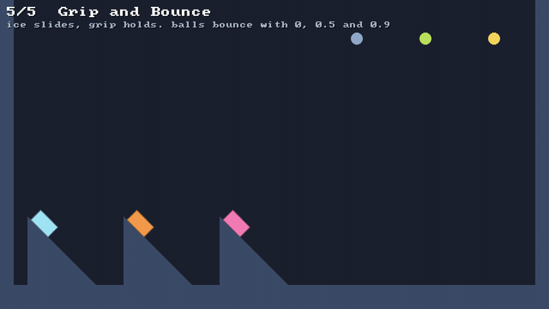

# 🧽 Friction and bounce

⚡ **Every surface has a material: how much it grips while sliding, how much it grips at rest, and how much it bounces.**



## 🧠 How it works

- 👉 **sliding** loses `friction × how hard it's pressed on`. that's Coulomb's law, one substep at a time 🛝
- 👉 **at rest**, it stays put as long as the pull along the surface is under `staticFriction × the press` 🧲
- 👉 **bouncing** sends back `restitution` of the speed it hit with. the height goes with the square: 0.9 bounces back 81% as high 🏀

<details>
<summary>🤓 the details</summary>

```kotlin
val grip = Material(friction = 1.5f, staticFriction = 2f)
val ball = world.particles.add(100f, 50f, radius = 7f, material = Material(restitution = 0.9f))
val box  = world.softBody(shape, 200f, 300f, material = Material.RUBBER)
world.solids!!.fill(4, 20, SolidShape.FALLING, material = Material.ICE)   // 🧊 a slippery ramp
world.softBodies.setMaterial(box, Material.ICE)                          // or change it later
```

Ready-made: `Material.DEFAULT` (0.4, 0.6, no bounce), `Material.ICE` (no grip) and `Material.RUBBER`
(0.9, 1.2). Everything is `DEFAULT` unless you say otherwise.

**Two materials meet.** Grip mixes by the **geometric mean**, `√(a·b)`, so ice on anything is ice.
Bounce takes the **larger**, so a rubber ball bounces on a stone floor. 🪨

**"How hard it's pressed on" is a distance.** There are no forces here, only moves. Every push a
particle gets out of a surface or a body in one substep is added up: that's its press. Then, once,
just before the last pass, `applyFriction` looks at how far the particle slid along the surface,
relative to whatever it touched:

```kotlin
val held = if (slide < staticFriction * press) slide          // 🧲 at rest: undo the whole slide
           else min(slide, friction * press)                   // 🛝 sliding: undo some of it
// move the particle back by `held`, and what it touched forward, split by mass
```

Only once a substep, not every pass: a soft body's own constraints tug its dots back and forth
between passes, and only what's left near the end is really sliding. And before the last pass, so
walls and bodies still get the last word.

**Bounce happens in the push.** When a solid pushes a particle out, the speed going into the
surface is turned around and kept `restitution` of it, instead of being dropped. Below
`PhysicsConfig.bounceSpeed` nothing bounces, so resting things settle instead of buzzing. 🐝

</details>

## 🎛️ The knobs

| knob | default | turn it up 🔼 | turn it down 🔽 |
|---|---|---|---|
| `Material.friction` | `0.4` | slides less, stops sooner | slides further. `0` is ice 🧊 |
| `Material.staticFriction` | `0.6` | stays put on steeper slopes: it holds while this is over the slope's tangent | starts sliding sooner |
| `Material.restitution` | `0` | bouncier, up to `1` | `0` stops dead |
| `PhysicsConfig.bounceSpeed` | `40` units/s | more settles without bouncing | small bounces buzz on and on |

## 💥 Gotchas

- 💥 **Static friction only holds what's still.** A box that *lands* on a slope arrives sliding, and
  only `friction` works on it then. Set things down at rest (`softBodies.rotate`, then place them)
  if they should stay put.
- 💥 **Soft and heavy-cored rolls.** On a steep slope a soft body's core sags downhill until the body
  is round, and then it **rolls**. No grip stops a wheel: the default dome already rolls down 30°,
  and even a firm one rolls down 40°, whatever its material. Make it stiffer (lower compliances) to
  make it slide or stick.
- 💥 **Soft bodies don't bounce much.** Restitution bounces the skin dots that hit, but the heavy core
  keeps going down and the springs soak it up. Bounce is for balls and grains; a blob's spring is its own.
- 💥 **Right on the edge, it's a coin toss.** Constraints are solved one after another, always round
  the ring the same way, so a box with grip just over the slope's tangent can hold on a ramp one way
  and creep down its mirror image. Give it some margin: 2 rather than 1.2 on a 45° slope.
- 💥 **Friction holds poses.** In a pile, grip keeps squashed bodies squashed instead of letting them
  slump. That's what makes stacks stand, and why the bottom of a pile can stay stretched for a while.

## 🧪 Try it

`./gradlew :demo:run`, scene `5` **Grip and Bounce**. On the left: 🧊 ice slides off at once, 🟧 the
default slides, 🩷 grip holds. On the right the balls bounce with restitution 0, 0.5 and 0.9. Every
five seconds it starts again. `F1` three times shows the contacts and their normals.

📸 `scripts/capture.sh 5 friction --from 0 --to 2.6 --clean`
