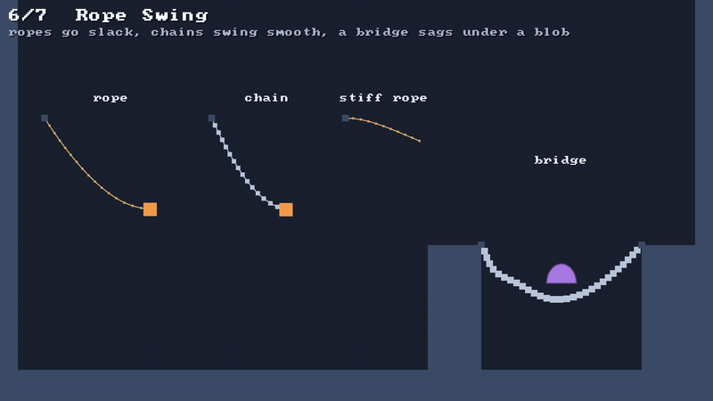

# 🖐️ Grab

⚡ **Click a particle and drag it: a soft pin pulls it towards the mouse, and never yanks hard enough to break anything.**



## 🧠 How it works

- 👉 `world.grab(x, y)` takes hold of the nearest particle that can move, within reach, with a soft [📌 pin](constraints.md) 🖐️
- 👉 `world.moveGrab(x, y)` moves the pin's point; the particle, and whatever it's tied to, follows 🎈
- 👉 however far the mouse jumps, the pin pulls from at most `maxPull` away, so a fling drags a body quickly but never tears it 🛡️

<details>
<summary>🤓 the details</summary>

```kotlin
// mouse down
world.grab(mouse.x, mouse.y)          // the particle it took, or -1 when nothing was in reach
// every frame the button is held
world.moveGrab(mouse.x, mouse.y)
// mouse up
world.release()

world.grabbed                         // which particle is held, or -1
world.hand.maxPull = 8f               // pull more gently
```

**One hand.** There's one grab per world, like one mouse. Grabbing again lets go of the last one
first.

**It's just a pin.** The hand is an ordinary pin constraint with a little compliance, so it goes
through the same solver as everything else. The world adds it on `grab`, removes it on `release`,
and lets go by itself if the particle is removed.

**The clamp.** At the start of every step, the pin's target is put back to within `maxPull` of the
particle:

```
 particle ●──────12──────▸ pin            ✋ mouse, 600 units away
          └─ the pin pulls from here, not from the mouse
```

So the pull is never more than a pin stretched by `maxPull`. A soft body follows the mouse as fast
as that pull can drag it, and arrives in one piece.

**In the sandbox** 🎮 the left mouse button grabs and drags, and the right one adds each scene's own
thing: a blob, a ball, a burst of grains, a spring.

</details>

## 🎛️ The knobs

| knob | default | turn it up 🔼 | turn it down 🔽 |
|---|---|---|---|
| `reach` | `24` | grabs from further away | you have to click right on it |
| `compliance` | `0.00005` | a rubbery hand, things sag from it | a firmer grip |
| `maxPull` | `12` | follows a fast mouse more closely | gentler, things lag behind |

## 💥 Gotchas

- 💥 **Keep `maxPull` under a tile.** Pulled from further than about half a tile, a particle can be
  dragged more than halfway into a floor in one step, and pushed out of its far side. Its body is
  then split across the floor. 12 is safe for 16-unit tiles.
- 💥 **You grab a particle, not a body.** Grab a blob by its edge and the edge stretches before
  the rest follows. That's the fun of it, but grab near the middle for a cleaner lift.
- 💥 **Static particles can't be grabbed.** Pinned rope ends and cloth's top row are skipped:
  move those with `particles.moveTo` instead.
- 💥 **A world swapped out lets go.** The Cloth scene builds a new world when it hangs the net back
  up, and the hand stays with the old one. Click again.

## 🧪 Try it

`./gradlew :demo:run`, any scene: drag things with the left mouse button, add things with the
right. In scene `6` **Rope Swing**, lift the blob off the bridge and drop it on a ledge.

📸 `scripts/capture.sh 6 grab --from 0.3 --to 4.5 --clean --drag 504,252`
