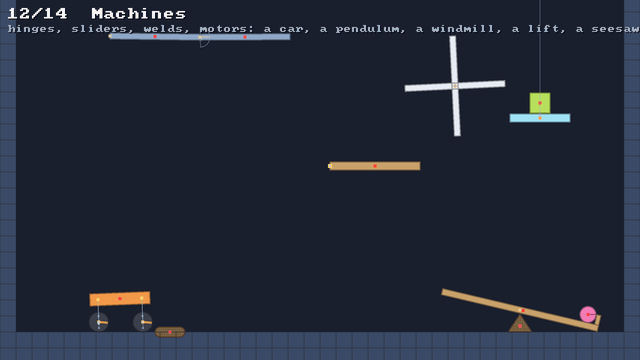

# 🔩 Joints and motors

⚡ **Pin two bodies together at a point, along a line, or solid, and let a motor turn them: cars, lifts, pendulums.**



## 🧠 How it works

- 👉 a joint holds a point of one body, its **anchor**, where it should be on the other: on top of it, on a line through it, or a set distance away 📍
- 👉 it pulls them there every pass, split by how hard **each** is to move at that point, and turns them to the **angle** they should have, if it keeps one 🔄
- 👉 a **motor** is a joint aimed a little further on each substep, with only so much **torque** to get there 🏎️

<details>
<summary>🤓 the details</summary>

```kotlin
val joints = world.joints
val axle = joints.hinge(car, wheel, wheelX, wheelY)           // at that point, free to turn
joints.setMotor(axle, speed = 9f, maxTorque = 2e7f)           // radians a second, at most this torque

val lift = joints.slider(platform, Joints.WORLD, x, y, 0f, 1f) // only up and down
joints.setLimits(lift, -120f, 0f)                             // from 120 down to where it was made

val shelf = joints.weld(plank, Joints.WORLD, x, y, breakForce = 1.6e5f)   // removed above that force
val stick = joints.distance(a, Joints.particle(p), ax, ay, px, py)        // to a particle, too

joints.angle(axle)        // how far it has turned, in radians
joints.position(lift)     // how far it has slid, in units
joints.force(shelf)       // what it held with, last substep
```

**Ends.** A joint's first end is a rigid body. Its second is another body, `Joints.WORLD`, a fixed
point, or `Joints.particle(p)`. A particle has no angle, so a joint to one holds only where it is:
a hinge to it is a pin, a slider to it a bead on a wire.

**Pulling the anchors together.** As for a contact ([🧱 stacking](stacking.md)): the anchors are `d`
apart along `n`, and each end is as easy to move there as `w = 1/m + (r × n)²/I`, where `r` is from
its centre to its anchor. A push of `d / (w₁ + w₂)` moves the two anchors together, each end by its
share, turning it as it does. With a compliance `α` it's `d / (w₁ + w₂ + α/h²)`, and a little is
left: the joint gives like a spring.

**Turning to an angle.** A weld and a slider also hold the angle between their ends, the angle they
had when they were made. The turn is split by inverse inertia, `1/I₁ + 1/I₂`.

| joint | holds | free to |
|---|---|---|
| `hinge` | the anchors together | turn about them |
| `slider` | the anchors on a line, and the angle | slide along the line |
| `weld` | the anchors together, and the angle | nothing, until it breaks |
| `distance` | the anchors a set distance apart | turn, and swing about each other |

**Limits.** A hinge's angle or a slider's position past its limit is pushed back to it, every pass.

**Motors.** At the start of each substep, a motor's target is where the joint was plus the speed
times the substep. Each pass pulls toward it, but the push it adds up is kept under `maxTorque` (or
the force, for a slider) times `h²`: that's how a weak motor stalls under a heavy load.

**Breaking.** At the end of each substep, a joint's force is how hard it pulled, `λ / h²`. A weld
pulled harder than its `breakForce` is removed.

**No colliding.** Two bodies joined to each other don't collide: a wheel can sit inside its car.

</details>

## 🎛️ The knobs

| knob | default | turn it up 🔼 | turn it down 🔽 |
|---|---|---|---|
| `compliance` (weld, distance) | `0` | it gives, like a spring | rigid |
| `breakForce` (weld) | never | it bears more | it snaps sooner |
| `setLimits(lower, upper)` | none | a wider swing or slide | a narrower one: equal, and it's locked |
| `setMotor(speed, …)` | off | faster | slower; negative turns it the other way |
| `setMotor(…, maxTorque)` | | it drives harder, up hills, under loads | it stalls under them; `0` is off |
| `PhysicsConfig.substeps` | `4` | a pendulum keeps its swing longer | it slows sooner |

## 💥 Gotchas

- 💥 **Which way is positive?** A joint's angle is how far its *second* end has turned against its
  *first*. With the world as the second end, an arm turning clockwise is a *negative* angle, and a
  motor of positive speed turns it anticlockwise. Our tests had it backwards, twice.
- 💥 **Pendulums slow down.** Each substep's projection takes a little off a swing: about 4% a second
  at the default 4 substeps, a fifth of that at 16. The period is right either way. The demo
  runs 8 substeps for its pendulum.
- 💥 **A drop is a spike.** A crate dropped on a welded shelf stops in one substep, and the force
  that takes is many times its weight, so a weld strong enough for three crates broke at the first
  one dropped. Set them down gently, or give the weld room for the spike.
- 💥 **A weld breaks on force, not torque.** It weighs how hard its anchors are pulled together. A
  long shelf's bending is held by its angle, which doesn't break it.

## 🧪 Try it

`./gradlew :demo:run`, press `]` until **Machines**, the 12th scene, then `F1` twice for the joints:
a double pendulum, a car on motorised wheels, a shelf that bears three crates and breaks at the
fourth, a lift on a slider. Right click to drop crates on the lift. 🏗️

📸 `scripts/capture.sh 12 joints --from 0 --to 7.5 --clean --view 2 --width 640`
