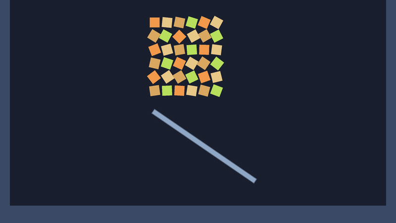

# 🔌 Using it in a klyph game

⚡ **One line runs the physics in your app. One component makes a sprite follow a body.**



## 🧠 How it works

- 👉 `addPhysics(world)` steps the world in klyph's **fixed step**, 60 times a second however fast the screen draws ⏱️
- 👉 an entity with a `PhysicsBody` and a `Transform` is **moved to its body** after every step: place and angle 📍
- 👉 add klyph's `Interpolated` and it's drawn **between the last two steps**, so it glides at 144 Hz too 🧈

<details>
<summary>🤓 the details</summary>

```kotlin
fun main() = runApp(AppConfig(title = "crates", fixedRate = 60)) {
    val physics = addPhysics(PhysicsWorld().apply { solids = level })   // level: your SolidGrid

    val box = physics.world.rigidBody(Shape.box(16f, 16f), 100f, 40f)
    val crate = world.create()
    world.add(crate, Transform, Transform())
    world.add(crate, Sprite, Sprite(assets.whitePixel, width = 16f, height = 16f))
    world.add(crate, PhysicsBody, PhysicsBody.rigid(box))
    world.add(crate, Interpolated, Interpolated)
}
```

**Three kinds of body** 🧩:

| link | the entity goes to | and turns |
|---|---|---|
| `PhysicsBody.rigid(box)` | its centre of mass | with the body |
| `PhysicsBody.soft(blob)` | the middle of its ring | as its first ring point goes round the middle |
| `PhysicsBody.particle(p)` | the particle | not at all |

**Where it fits in a step** 🔁: klyph runs a phase's systems in the order they were added. So in
`FIXED_UPDATE`:

```kotlin
addSystem(Phase.FIXED_UPDATE) { app -> /* push the player, start motors, spawn */ }
val physics = addPhysics(world)                            // steps, then moves the linked entities
addSystem(Phase.FIXED_UPDATE) { app -> /* read contacts and sensors: app.physics.world.events */ }
```

**Finding it again** 🔎: `addPhysics` also keeps the `Physics` as a resource, so any system can say
`app.physics.world`.

**The sandbox runs on it** 🎮: each scene's `beforeStep` is the system before, `afterStep` the one
after. Pause and slow motion set `physics.isPaused`. When it records a GIF, it pauses `Physics` and
steps the scene once a frame, so every recording comes out the same.

</details>

## 🎛️ The knobs

| knob | default | what it does |
|---|---|---|
| `physics.world` | the one you gave | the world that's stepped. Swap it to change levels 🗺️ |
| `physics.isPaused` | `false` | stops the steps, and the entities with them ⏸️ |
| `physics.step(app.world, dt)` | | one step by hand, paused or not, then the entities follow 🐢 |
| `AppConfig.fixedRate` | `60` | steps a second. The physics takes klyph's fixed step as its `dt` |

## 💥 Gotchas

- 💥 **The order you add systems in matters.** A system added after `addPhysics` that pushes a body
  pushes it for the next step, a step late.
- 💥 **Swapping the world doesn't relink entities.** An entity linked to box 3 follows box 3 of the
  new world, whatever that is. Remove or relink them.
- 💥 **A removed body leaves its entity where it was.** Destroy the entity too.
- 💥 **The link only goes one way.** Moving the `Transform` doesn't move the body: move the body, and
  the entity follows.
- 💥 **One `addPhysics` per app.** A second one fails. Swap `physics.world` instead.
- 💥 **A rigid body's place is its centre of mass.** For a box, its middle. For a hammer of two
  boxes, nearer the head: draw its sprite around that.

## 🧪 Try it

`SANDBOX_EXAMPLE=1 ./gradlew :demo:run` runs the README's example: 36 crates as klyph sprites, a
plank, and nothing drawn by the physics but the room and the plank. The code is
`demo/src/nativeMain/kotlin/klyph/physics/demo/Example.kt`.

📸 `scripts/capture.sh --example add-physics --to 5`
