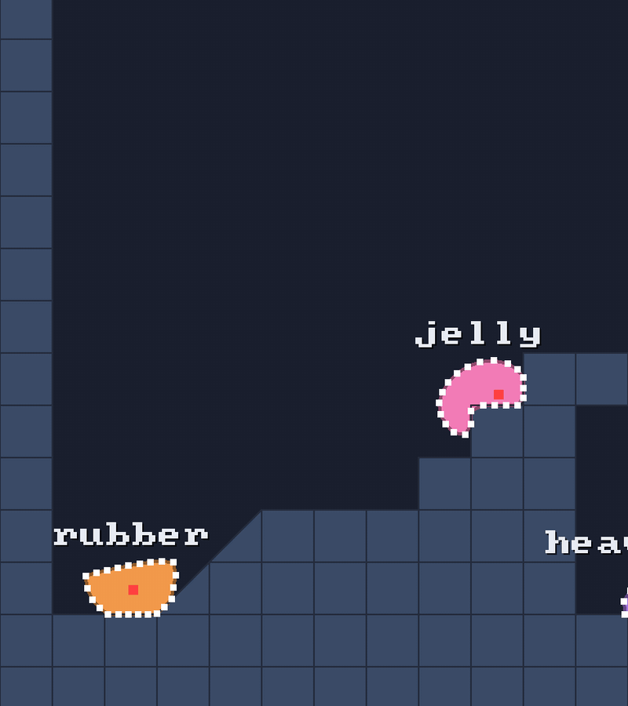

# 🌀 Outline

⚡ **One place that answers "is this point inside the blob?", even when the blob has folded over itself.**



## 🧠 How it works

- 👉 **inside** = the skin **winds around** the point. not "crosses an odd number of times"
- 👉 **spans**: cut the blob at one height, get the stretches that are inside. draw those row by row = a filled blob 🎨
- 👉 **nearest point**: the closest spot on the skin, for pushing things out of a body

<details>
<summary>🤓 the details</summary>

**Winding vs even-odd** 🌀: shoot a ray to the right from the point and walk the skin. Every edge
that crosses the ray going down adds 1, going up takes 1 away. Not zero? Inside.

Even-odd just counts crossings. Fold a blob over itself and the folded part is crossed twice:
even = "outside" = a **hole** that flickers in and out as it wobbles. Winding says that part is
wound around twice, so it's solid. 🧱

```kotlin
val ring = world.softBodies.ring(blob)       // any Ring works: a body's skin is one
Outline.contains(ring, x, y)                 // true / false
Outline.spans(ring, y, left, right)          // how many stretches; they're in left[i]..right[i]
Outline.nearestPoint(ring, x, y, out)        // squared distance; the point goes in out[0], out[1]
```

**Spans** is how the bridge's `DebugDraw` fills a blob: one row per world unit, a thin rectangle
per stretch. No triangulation, no allocation. `left` and `right` are your arrays, sized to the ring.

**Half-open edges** ✂️: an edge counts at height `y` if one end is `<= y` and the other isn't. A ray
that goes exactly through a dot counts it once, never twice.

</details>

## 🎛️ The knobs

| knob | what it does |
|---|---|
| `left`, `right` arrays | at least `ring.ringCount` long. you own them, so nothing allocates |
| `DebugDraw` row height | `1` world unit. smaller is smoother and costs more draw calls |

## 💥 Gotchas

- 💥 **Arrays too short = crash.** `spans` writes up to `ringCount` entries.
- 💥 **The skin only.** The core isn't part of the outline, and neither are the spokes.
- 💥 **On the line = outside, maybe.** A point exactly on an edge may come out either way. Use
  `nearestPoint` when you need "how far in".

## 🧪 Try it

`./gradlew :demo:run`, scene `1` **Blob Garden**. Every blob is filled with `Outline.spans`. Watch
the 🩷 jelly flop and stay solid.

📸 `scripts/capture.sh 1 outline --from 9 --to 10.5 --details --clean --slow --crop 0,0.4,0.3,0.6`
