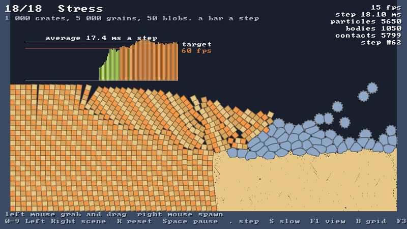

# 🏎️ Making it fast

⚡ **5 000 grains, 1 000 crates and 50 blobs in about 19 ms a step, on one thread, by doing less work and calling fewer functions.**



## 🧠 How it works

- 👉 **look less**: cells sized to what's in them, only the pairs that matter, and a pair that hardly moved keeps last substep's contacts 🙈
- 👉 **copy less**: last substep's contacts are kept by swapping two sets of arrays, not copying one into the other 🔁
- 👉 **call less**: on Kotlin/Native every function call has a cost, so the work done for every pair is inlined into the loop over pairs 📞

<details>
<summary>🤓 the details</summary>

**The stress world** 💪: `StressWorld` in the demo is what the targets are measured on: 1 000
crates 8 units wide in a block, 5 000 grains of sand 1.25 units across heaped beside it, and 50 blobs
dropped onto the sand. It runs at 8 substeps of 2 passes each.

**What each change saved** ⏱️, on the whole stress world, at 8 substeps of 1 pass:

| change | step |
|---|---|
| before | 29 ms |
| 📏 cells as big as the average box, not a fixed 32 | 24.5 ms |
| 💤 the rigid–soft broadphase pairs only grain with crate | 22.5 ms |
| 🙈 contacts kept for pairs that hardly moved, the pair code inlined | 20.4 ms |
| 🔁 last substep's contacts swapped, not copied | 18 ms |
| 🏖️ grains that can't meet this step left unpaired | 17.5 ms |
| 🧭 the edge and inside test for a grain against a blob in one pass | 16 ms |
| 📞 the pair solvers inlined | 15.5 ms |

A second pass per substep, which the sand heap needs, brings it to about 19 ms.

**📏 Cells that fit.** With 32-unit cells, about 140 grains landed in each cell, and every one was
compared with every other. `PhysicsConfig.cellSize` is now `Broadphase.AUTO`: at every `build` the
cells are made as wide as the average box's longer side. See [🗂️ Broadphase](broadphase.md).

**💤 Passive boxes.** The rigid–soft coupling only wants grain–crate pairs. It files grains and
blob boxes as `passive`, so two passives are never paired, and uses `activeWithActive = false`, so
two crates aren't either. Before that it found every grain–grain and crate–crate pair and threw them
away.

**🙈 Keeping contacts.** Each substep, a pair of bodies remembers where B was in A's frame. Next
substep, if it has moved less than `MARGIN / 50` (0.01 units) and turned less than 0.002 radians, the
narrowphase is skipped. Last substep's contacts are copied instead, their normal turned with A, and
their points kept where they were on each body. A pair that's closing fast, or sliding, looks again.
In a resting pile almost every pair is kept.

**🔁 Swapping, not copying.** Kept contacts are read from last substep's arrays. There are two sets of
arrays: each substep the new contacts go into one while the other holds the old. At the start of a
substep the two are swapped, so nothing is copied. Copying them took 1.7 ms a step; swapping takes
0.05.

**🏖️ Grains that can't meet.** The sand broadphase is built once a step, with every box grown by the
whole step's move, so it finds many pairs that can never touch. Before the substeps, each grain pair
is checked once: are the two circles within their radii, the margin, and as far as both move this
step? If not, the pair is dropped, and the substeps never see it.

**📞 Calls cost on Kotlin/Native.** A function that holds references to objects sets up a frame for
the garbage collector on every call: it zeroes a block of memory sized to how many references it
holds, looks up thread-local storage, and links and unlinks the frame. For a function called a
million times a step, that cost is bigger than the work done in it. So:

- the work for each pair is `inline` and expands into the loop over all the pairs, called once
- what's rarely needed, like the full narrowphase, stays a separate function, so the loop's frame stays small
- arrays used in a hot loop are read into local variables first

Inlining into a function called once per pair doesn't help, though. Its frame only grows: one such
function went from zeroing 600 bytes a call to 1 672.

**Not done yet** 🧵: everything here runs on one thread. Islands that don't touch could be solved on
separate threads, and the grains could be split into strips. That's
[#78](https://github.com/pererikbergman/klyph-physics/issues/78).

</details>

## 🎛️ The knobs

| knob | default | turn it up 🔼 | turn it down 🔽 |
|---|---|---|---|
| `PhysicsConfig.cellSize` | `AUTO`: the average box | fewer filings, more pairs in each cell | more filings for big things |
| `PhysicsConfig.substeps` | `4` | stiffer piles and faster things caught, slower | faster, softer |
| `PhysicsConfig.iterations` | `6` | stiffer, slower | faster. under 2, deep heaps of sand burst |
| `PhysicsConfig.timeToSleep` | `0.5` s | piles take longer to stop costing | piles sleep sooner, and may sleep mid-wobble |

**The targets** 🎯, as averages over 600 steps on an M-series Mac, on one thread, with nothing asleep:

| workload | average | target |
|---|---|---|
| 🏖️ 5 000 grains | 5.5 ms | under 8 ms |
| 📦 1 000 crates | 7.0–7.5 ms | under 8 ms |
| 🍮 50 blobs | 1.2 ms | under 8 ms |
| 💪 all of them | 19 ms | under 20 ms |

All of them together don't fit in a 60 FPS frame yet. Splitting the work across threads is what
should get them under one.

## 💥 Gotchas

- 💥 **Measure the release build, run directly.** A debug build is about 12 times slower. Run
  through Gradle, times come out slower and uneven. `scripts/bench.sh` does it right.
- 💥 **Sleeping hides the cost.** 1 000 crates take 1.6 ms a step on average, but 9 ms at the
  start, before they've fallen asleep. Time with `timeToSleep = Float.POSITIVE_INFINITY` to see the
  worst case.
- 💥 **One pass a substep isn't enough for deep sand.** The weight of a heap 50 grains deep takes too
  long to reach the bottom, and grains squeezed into the corners shoot out. Two passes holds it.
- 💥 **Two grains closing by more than a grain's width in one substep pass through each other.** Bullet
  sweeps stop things passing through walls, not through each other. Use more substeps if grains move
  that fast.

## 🧪 Try it

`./gradlew :demo:runRelease`, then `→` to the last scene, **Stress**. The graph in the corner is each
of the last 120 steps: green while a step fits in a 60 FPS frame, orange when it doesn't. Right
click to drop 25 more crates, a blob, or 250 grains, in turn.

```
scripts/bench.sh            # time every scene, then the stress world in parts and as a whole
scripts/bench.sh stress     # just the stress world
scripts/bench.sh 8          # just scene 8, Sand
scripts/bench.sh profile &  # step the stress world untimed for a profiler...
sample $(pgrep demo.kexe) 10   # ...and see where the time goes
```

📸 `scripts/capture.sh 18 stress --release --from 1 --to 5`
