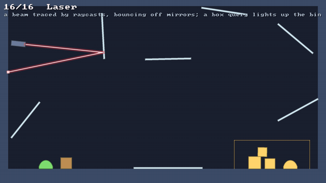

# 🔦 Raycasts and queries

⚡ **Ask the world what is where: the first thing along a line, everything at a point, everything in a box.**



## 🧠 How it works

- 👉 a **raycast** finds the first thing a line hits: where, the surface's normal, how far along, and what it was 🎯
- 👉 a **point query** finds everything a point is inside; a **box query** everything that reaches into a box 📦
- 👉 rigid bodies by their shapes, soft bodies by their outlines, the level by its open faces 🧱
- 👉 you own the result, so asking allocates nothing ♻️

<details>
<summary>🤓 the details</summary>

```kotlin
val hit = RayHit()          // make these once and keep them
val found = Overlaps()

if (world.raycast(x, y, x + dx * 500f, y + dy * 500f, hit)) {
    hit.x; hit.y            // where
    hit.normalX; hit.normalY // the surface, facing back at the ray
    hit.fraction            // 0 at the start, 1 at the end
    when (hit.what) {
        HitKind.RIGID_BODY -> hit.body   // and hit.shape, which of its shapes
        HitKind.SOFT_BODY -> hit.body
        HitKind.SOLID -> hit.solid
        HitKind.NOTHING -> {}
    }
}

world.queryPoint(mouseX, mouseY, found)                  // under the mouse
world.queryBox(left, top, right, bottom, found, Query.RIGID_BODIES)
for (i in 0 until found.rigidBodyCount) found.rigidBody(i)
```

**A ray against a shape.** Every shape is a convex core grown by a radius (see
[🔷 Shapes, mass and inertia](shapes.md)). A sharp polygon is clipped face by face: the ray is inside it
between the last face it goes in through and the first it comes out of. A rounded one, a circle or a
capsule, is its faces moved out by the radius plus a circle at each corner: the nearest of those it
goes into is where it hits. The ray is turned into the body's own frame first, so the shape never
moves.

**A ray against a soft body** crosses its outline: the first edge it crosses is where it goes in.
**Against the level**, it crosses the solids' open faces, the same edges rigid bodies collide with,
already merged, with the faces between two tiles buried. Only faces it comes at from outside count.

**Starting inside.** A ray doesn't hit what it starts inside. So a ray from a surface, going out,
doesn't hit that surface again: the laser starts each bounce right where the last one hit. 🔁

**A point query** asks each shape, outline and solid whether the point is inside, the same question
grabbing with the mouse asks. **A box query** checks a rigid shape by separating axes, the box's two
and the core's faces, and when they're apart, whether they're closer than the shape's radius. A soft
body is in a box if an edge of it crosses the box or the box is all inside it; a slope tile if the
box's lowest corner along its surface is under it.

**Allocation-free.** `RayHit` and `Overlaps` are yours. A query writes into them, and an `Overlaps`
only allocates the few times it has to grow.

**Fast enough, not clever.** Each query walks every body, and skips one in a single test if the
ray or box misses the circle round it. That's microseconds for the hundreds of bodies a scene has.
The level is looked up by its grid.

</details>

## 🎛️ The knobs

| knob | default | what it does |
|---|---|---|
| `what` | `Query.EVERYTHING` | `Query.RIGID_BODIES`, `SOFT_BODIES` and `SOLIDS`, or'ed together: what to look at |
| the ray's length | yours | the ray stops at its end: a short one is cheaper |
| `Overlaps(initialCapacity)` | `16` | how many of each it holds before it grows |

## 💥 Gotchas

- 💥 **A ray from inside goes out.** It doesn't stop where it starts: it finds the next thing. To
  ask what's at the start, ask `queryPoint`.
- 💥 **A ray along the floor's inside hits nothing.** The faces between two floor tiles are buried,
  so there's nothing to hit until it comes out of the floor.
- 💥 **The brute-force test can't start inside things.** It walks the ray asking `queryPoint`, and
  can't tell what the ray starts in from what it enters, so its rays start in the open.
- 💥 **The test was checked by breaking things.** Ignoring a capsule's sides, a slope's surface or
  one soft body each made the brute-force tests fail, so they test what they say.

## 🧪 Try it

`./gradlew :demo:run`, press `→` until **Laser** ([`Laser.kt`](../../demo/src/nativeMain/kotlin/klyph/physics/demo/Laser.kt)).
The beam is one raycast per bounce, turned about the normal each time; the thin white ticks are the
normals. Right click to drop a crate or a blob in its way, or in the bin to light it up. 🔦

📸 `scripts/capture.sh 16 laser --from 0 --to 8 --clean --width 640`
