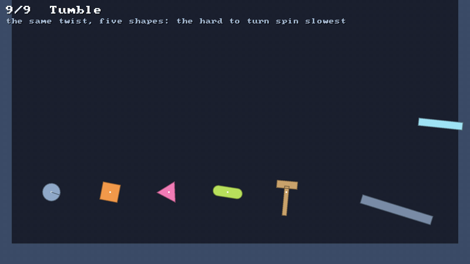

# 📦 Rigid bodies and rotation

⚡ **A rigid body is one thing that moves and turns: a position, an angle, and a velocity for each.**



## 🧠 How it works

- 👉 a body is an **`Int`**, like a particle: its centre, its angle, and how fast each changes, in plain arrays 📦
- 👉 each substep it **moves by its velocity**, the solver pushes it about, and its new velocity is **how far it really went** 🏃
- 👉 three kinds: **dynamic** falls and gets pushed, **kinematic** goes exactly where it's told, **static** never moves 🧭

<details>
<summary>🤓 the details</summary>

```kotlin
val bodies = world.rigidBodies
val crate = bodies.add(x = 100f, y = 50f, mass = 2f, inertia = 300f)  // 👈 an Int, like a particle
bodies.setVelocity(crate, vx = 200f, vy = -400f)
bodies.setAngularVelocity(crate, 6f)                                // radians a second, clockwise

val lift = bodies.add(300f, 200f, kind = BodyKind.KINEMATIC)
bodies.moveKinematic(lift, 300f, 180f)                              // there at the end of the next step

world.step(1f / 60f)
bodies.angle(crate)                                                 // 0.1: it turned a tenth of a radian
```

**One substep, for a dynamic body** (Müller et al. 2020, *Detailed Rigid Body Simulation with
Extended Position Based Dynamics*):

```
prev = position                 remember where it was
v   += gravity · h              then move by its velocity
x   += v · h      θ += ω · h
solve                           contacts and joints push it, by position and angle
v   += moved by the solver / h  the velocity is how far it really went
```

That's [🏃 Verlet](verlet.md) again, with velocities kept on the side. A particle can do without:
its velocity is just where it was. A body can't: turning has no "where it was" to subtract without
losing the spin's low digits once the angle is big, so the velocity is kept, and the solver's pushes
are added to it.

**Mass and inertia.** Mass is how hard a body is to push; inertia is how hard it is to turn. A push
off the centre does both: it moves the body by the push over the mass, and turns it by the push's
torque over the inertia. That's the solver's one way of moving a body. Give a body a shape and it
works both out from its size and density: see [🔷 shapes](shapes.md).

**Kinematic bodies** are given a velocity, or told where to be with `moveKinematic` every step, and
go there exactly: gravity, contacts and joints don't touch them. They push dynamic bodies out of the
way and are never pushed back. Lifts, platforms, paddles.

**Spin doesn't change the fall.** Gravity pulls on the centre, so it never turns anything. Toss five
shapes with different spins and they fly the same arc. 🎯

</details>

## 🎛️ The knobs

| knob | default | turn it up 🔼 | turn it down 🔽 |
|---|---|---|---|
| `mass` | `1` | harder to push | flies off at a touch |
| `inertia` | `1` | harder to turn, it spins on for longer when it does | turns at a touch |
| `kind` | `DYNAMIC` | | `KINEMATIC` goes where it's told, `STATIC` stays put |
| `PhysicsConfig.damping` | `0.24` | spinning and moving both die away faster | both keep going |
| `PhysicsConfig.maxStep` | `4` | fast bodies go faster | a thrown body is capped at this per substep |

## 💥 Gotchas

- 💥 **The angle isn't wrapped.** Two turns is 4π, not 0. Wrap it yourself if you show it.
- 💥 **Clockwise is positive.** y grows down, so a positive angle turns clockwise on screen.
- 💥 **A body is its centre.** Its position is the point it turns about, its centre of mass, not a corner.
- 💥 **Velocity from positions loses spin.** Working velocity out as `(θ - θprev) / h` threw away a
  spinning bar's speed a little more every step, once its angle was in the tens. Counting the
  solver's pushes instead keeps every digit.
- 💥 **Damping takes the spin too.** A spinning body slows down at the same rate a moving one does.
  For a top that spins forever, set `damping = 0`.

## 🧪 Try it

`./gradlew :demo:run`, press `9` for **Tumble** ([`Tumble.kt`](../../demo/src/nativeMain/kotlin/klyph/physics/demo/Tumble.kt)): five shapes tossed up with different spins come
down together, and the paddle on the right goes round its circle exactly where it's told.

📸 `scripts/capture.sh 9 rigid-bodies --from 0 --to 4 --clean`
