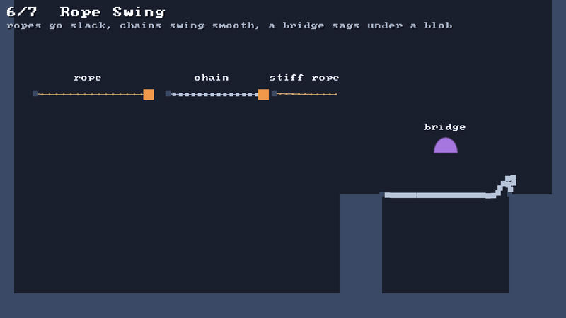
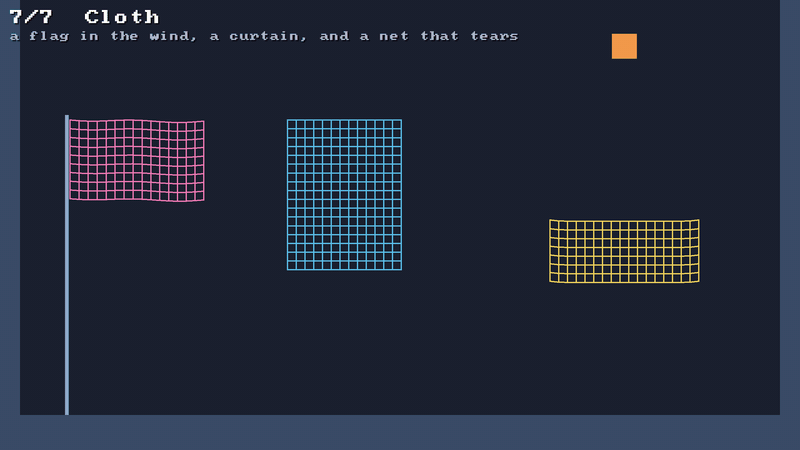

# 🪢 Ropes, chains and cloth

⚡ **One line makes a rope, a chain or a sheet of cloth: ordinary particles, tied together by the constraints you already know.**



## 🧠 How it works

- 👉 a **rope** is a row of particles with a [🔗 rope link](constraints.md) between each pair: it pulls, but goes slack when pushed 🪢
- 👉 a **chain** is the same with rigid links that push too, heavier round links, and a little [🦴 bend](constraints.md) at every joint ⛓️
- 👉 a **cloth** is a grid: links along the rows and columns, links across every square, and bends along the rows and columns 🧣

<details>
<summary>🤓 the details</summary>

```kotlin
val rope  = world.rope(100f, 40f, 260f, 40f, segments = 20)                 // 🪢 hangs from its start
val chain = world.chain(300f, 40f, 400f, 40f, segments = 12, pinEnd = true)  // ⛓️ held at both ends
val stiff = world.rope(0f, 0f, 80f, 0f, segments = 10, bendCompliance = 0f)  // 🦴 holds its shape
val sheet = world.cloth(left = 400f, top = 40f, cols = 18, rows = 12, spacing = 7f,
                        tearAt = 1.4f)                                        // 🧣 top row pinned, tears

rope.particles     // the particles, end to end: grab one, hang a weight on the last
rope.links         // the links between them, so you can soften or tear one
sheet.particle(3, 5)                                                          // column 3, row 5
```

A `Strand` (rope or chain) and a `Cloth` are just **lists of handles**. The particles and constraints
live in the world like any others, so everything else works on them: collisions (`collides = true`),
friction, pins, `removeParticle`.

**The three kinds of cloth link.** 🧵

```
●───●───●     ─ │  structural: rows and columns. keep it from stretching
│ ╲╱│ ╲╱│     ╲ ╱  shear: both diagonals of every square. keep the squares square
│ ╱╲│ ╱╲│
●───●───●     and a bend over every three in a row or column: keep it from creasing
```

**Tearing** ✂️: give a link a `tearAt`, say `1.4`, and at the end of a step it breaks once it's
stretched past 1.4 times its rest length. A bend across a broken link breaks with it, so torn cloth
comes apart cleanly instead of hanging on by its bends. `constraints.tornCount` counts the breaks.

**Pinned means static.** `pinStart`, `pinEnd` and cloth's `pinned = { col, row -> … }` make those
particles static: they hold still until you move them with `particles.moveTo`. That's how a cloth
is dragged, and how the bridge's far end is moved onto its ledge so it sags.

</details>

## 🎛️ The knobs

| knob | default | turn it up 🔼 | turn it down 🔽 |
|---|---|---|---|
| `segments` | | smoother, more to solve | blockier, cheaper |
| `compliance` | `0` | stretchy, like elastic | `0` keeps its length |
| `bendCompliance` | rope: none. chain: `0.00001`. cloth: `0.0001` | floppier | stiffer. `0` sticks out straight |
| cloth `shearCompliance` | `0.001` | squares squash into diamonds | holds its shape |
| `tearAt` | `0` (never) | tougher | tears sooner. must be over `1` |
| `mass` | rope `1`, chain `2` | heavier, harder to swing | lighter |

## 💥 Gotchas

- 💥 **Heavy on light stretches.** A rope keeps its length within 1% on its own, but hang a weight
  many times heavier than its links on it and the solver can't quite hold it: the bridge stretches
  about 2% under a blob 30 times as heavy as a link. Make the links heavier, or add iterations.
- 💥 **A rope with no gaps.** A blob slips through a rope whose round particles don't touch. Make
  the particles as wide as the gap between them: `radius = length / segments / 2`.
- 💥 **Hold a stiff rope by two particles.** A bend needs three points. Pin only the first and the
  whole rope swings round it like a stick; pin the second too and it sticks out.
- 💥 **In 2D a ball can't hit a sheet's face.** It always meets an edge first, and a pinned edge
  is a wall. To tear a net, hold it by its sides and let the weight drag its free edge down.
- 💥 **Too many particles to collide.** Every colliding cloth particle goes in the broadphase. A
  20 × 20 sheet is 400 more particles; turn `collides` on only where something needs to hit it.

## 🧪 Try it

`./gradlew :demo:run`, scene `6` **Rope Swing**: a rope, a chain and a stiff rope, and a bridge that
holds a blob. Scene `7` **Cloth**: a flag in the wind, a curtain, and a ball that tears through a
net, hung back up every 8 seconds.



📸 `scripts/capture.sh 6 ropes --from 0 --to 4 --clean` and `scripts/capture.sh 7 cloth --from 0 --to 4 --clean`
