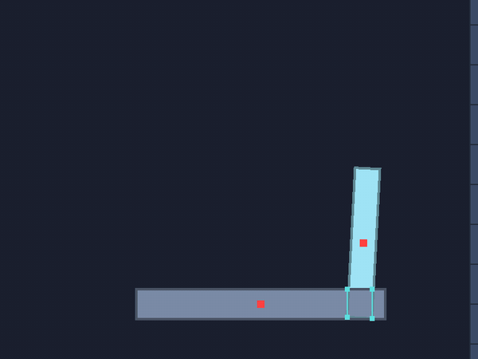

# ✂️ SAT and contact points

⚡ **When two shapes overlap, find the face they're least deep through, and clip: one or two exact points to push them apart at.**



## 🧠 How it works

- 👉 try **every face** of both shapes as a wall between them; the one the other shape reaches through **least** is the contact's face ✂️
- 👉 take the other shape's edge that faces it most, **clip** it to the face's two ends: what's left that reaches through is the contact, up to **two points** ✌️
- 👉 round shapes that don't quite touch at their cores are measured **exactly**, from their two nearest points 🎯

<details>
<summary>🤓 the details</summary>

```kotlin
val narrow = Narrowphase()
val m = Manifold()
if (narrow.collide(box, 0f, 0f, 0f, crate, 0f, 19.5f, 0.1f, m)) {
    m.count                 // 1 or 2
    m.normalX; m.normalY    // from the first shape to the second
    m.pointAX(0)            // on the first shape's surface
    m.pointBX(0)            // on the second's
    m.separation(0)         // -0.5: overlapping by half a unit
    m.id(0)                 // which edge and corner made it: the same next substep
}
```

**The separating axis test.** Two convex shapes don't overlap if some line lies between them, and
in 2D that line is always parallel to a face of one of them. So for every face of both, take its
outward normal, and find how far the other shape's nearest point is outside it. If any is outside,
they don't touch. If all reach through, the face reached through least is where they really meet,
and how deep is how far to push them apart.

```
   ┌──────┐           face of A, normal ↓
   │  A   │
   └──────┘ ─ ─ ─ ─   the other shape's points measured against it
 ┌───●──────●───┐     B's edge facing up, clipped to A's face's ends
 │      B       │
```

**Clipping.** The face of the other shape that points most against the chosen face is the
**incident** edge. It's cut off where it passes the ends of the chosen face, and each end left that
reaches through is a contact point. A box on a box gives two, at the corners of the smaller one,
and two keep it flat. A box on its corner gives one.

**Round shapes.** Every shape is a core grown by a radius ([🔷 shapes](shapes.md)), so the test is
run on the cores and the radii are added on. When the cores themselves don't touch, a capsule's end
near a box's corner say, the nearest points between them are found exactly, and the contact is along
the line between them, unless that line is along a face, in which case it's clipped for two points:
a capsule lying flat on a box doesn't rock.

**Feature ids.** Each point remembers which face and which corner made it, so the same contact can
be recognised from one substep to the next even as the bodies move.

**Prefer the first.** When both shapes' best faces are as good, within a hundredth of a unit, the
first shape's wins. A stack of boxes then keeps choosing the same face every substep instead of
flickering between two.

</details>

## 🎛️ The knobs

| knob | default | turn it up 🔼 | turn it down 🔽 |
|---|---|---|---|
| `margin` | `0` | shapes this close count as touching already, with a positive separation, so a solver can catch a contact before it happens | only real overlaps |
| `Shape.MAX_VERTICES` | `16` | | a polygon can have at most this many points |

## 💥 Gotchas

- 💥 **Convex only.** The test assumes it. That's why a concave point list is refused
  ([🔷 shapes](shapes.md)): build it from convex pieces.
- 💥 **A clipped round end lies a little inside.** Where a leaning capsule crosses the end of the
  face it's clipped to, its contact point can sit up to a fraction of its radius inside it. The
  depth and the normal are still right, which is what pushing apart needs.
- 💥 **Only the cores are clipped.** A rounded edge that leans across a face touches it with one end,
  not two: two points there would prop the capsule up on its middle.
- 💥 **A face that clips to nothing.** A capsule's end just past a box's corner, along the face's
  normal, clipped to the face, left no points at all. It now falls back to the one nearest point.
- 💥 **Two capsules in a line.** End to end, the faces of their cores look at each other sideways and
  can't see the gap between their ends, so they seemed to touch, and clipping left nothing: two
  capsules lying in a row on the floor went into each other. Whenever clipping finds nothing, the
  cores are now measured exactly.

## 🧪 Try it

`./gradlew :demo:run`, press `9` for **Tumble** ([`Tumble.kt`](../../demo/src/nativeMain/kotlin/klyph/physics/demo/Tumble.kt)), then `F1`: the
paddle on the right sweeps through the bar, and the contact points show where they overlap. One
where a corner pokes in, two where it lies flat. Neither is pushed: the paddle is kinematic and the
bar static, so both go only where they're told. For contacts that push, see
[🧱 stacking](stacking.md).

📸 `scripts/capture.sh 9 sat --from 0.5 --to 1.5 --slow --view 1 --clean --crop 0.68,0.45,0.3,0.4 --width 600`
