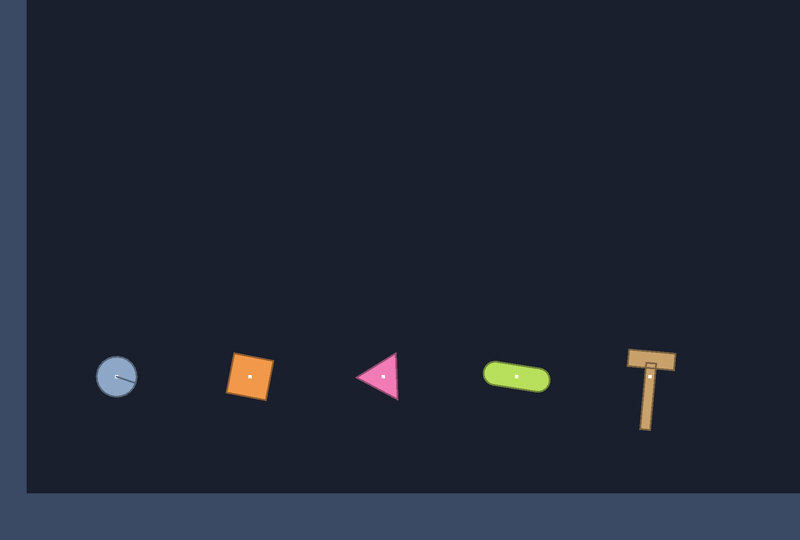

# 🔷 Shapes, mass and inertia

⚡ **A body is made of shapes: circles, boxes, convex polygons and capsules. Their size gives it its weight, and how hard it is to turn.**



## 🧠 How it works

- 👉 every shape is a **convex core grown by a radius**: a circle is a point, a capsule a segment, a polygon has no radius 🔷
- 👉 **mass** is area times density; **inertia** adds up how far each bit of area is from the middle, squared ⚖️
- 👉 a body of **several shapes** balances at their joint centre of mass, and that's the point it turns about 🔨

<details>
<summary>🤓 the details</summary>

```kotlin
val crate = world.rigidBody(Shape.box(32f, 32f), x = 100f, y = 50f)
val ball  = world.rigidBody(Shape.circle(10f), 200f, 50f, density = 0.2f)
val pill  = world.rigidBody(Shape.capsule(length = 30f, radius = 6f), 300f, 50f)
val wedge = world.rigidBody(Shape.polygon(0f, 0f, 30f, 0f, 0f, 20f), 400f, 50f)

// a hammer: two boxes around one origin, a compound body
val hammer = world.rigidBody(listOf(Shape.box(6f, 40f, y = 10f), Shape.box(30f, 10f, y = -15f)), 500f, 50f)
world.rigidBodies.y(hammer)   // 96.1: where it balances, near the head, not its origin at 100
```

**One way to describe them all.** Inside, a shape is a list of up to 16 core points and a radius:

```
circle    •          one point,  radius r
capsule   •────•     two points, radius r
polygon   ▲ ■ ⬟      3 to 16 points, radius 0
```

So collision code has three cases, not ten: point against point, point against polygon or segment,
and polygon or segment against each other.

**Mass and inertia** for a density of 1:

| shape | area | inertia about its middle |
|---|---|---|
| circle, radius r | πr² | m r² / 2 |
| box, w by h | wh | m (w² + h²) / 12 |
| polygon | a fan of triangles from its first point | each triangle's, moved to the middle |
| capsule, length l | 2rl + πr² | the box between the caps, plus two half discs moved out to its ends |

**Compound bodies.** Areas add up, and the centre of mass is their average weighted by area. Each
shape's inertia moves to that point with the parallel axis theorem: `I + m d²`. The body sits at
its centre of mass; `rigidBody(shapes, x, y)` puts the shapes' origin at `(x, y)`.

**Convex only.** A polygon whose points make a dent is refused, with the corner at fault, and so is
one that crosses itself or has three points in a line:

```
the polygon has a dent at (10.0, 5.0): a shape must be convex.
Make it from convex pieces instead, as a compound body
```

Points may go round either way; they're turned to go clockwise on screen.

**The same twist, five spins.** Give every shape the same angular impulse and each spins at that
over its inertia. A circle keeps its mass near its middle and spins fast; the hammer's head is far
from where it turns, so it spins slowest. 🌀

</details>

## 🎛️ The knobs

| knob | default | turn it up 🔼 | turn it down 🔽 |
|---|---|---|---|
| `density` | `0.05` | heavier, and harder to turn, by the same share | lighter |
| `radius` | | rounder, a circle or capsule grows | |
| `material` | `Material.DEFAULT` | grip and bounce, for when things touch | |

At the default density, a 32-unit crate weighs about 50, about as much as a blob.

## 💥 Gotchas

- 💥 **Concave shapes are refused.** An L or a star is two or more convex shapes in one body.
- 💥 **At most 16 points.** More than that is a circle in disguise: use a circle.
- 💥 **The body is at its centre of mass, not at the point you put it.** For one box made around its
  middle that's the same thing; for a hammer it isn't. Read `rigidBodies.x(b)` to see where it went.
- 💥 **Density is per unit squared.** A density of 1 makes a 32-unit crate weigh over a thousand,
  twenty blobs. Keep it near the default unless you mean it.

## 🧪 Try it

`./gradlew :demo:run`, press `9` for **Tumble** ([`Tumble.kt`](../../demo/src/nativeMain/kotlin/klyph/physics/demo/Tumble.kt)): five shapes tossed with the same twist. The dot on
each is its centre of mass. Grab one with the mouse: it hangs from the point you took it by.

📸 `scripts/capture.sh 9 shapes --from 0 --to 3 --clean --crop 0,0.1,0.75,0.9`
