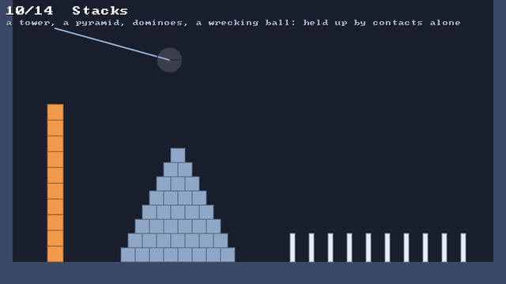

# 😴 Sleeping

⚡ **A pile that has stopped moving stops costing anything, until something knocks it.**



## 🧠 How it works

- 👉 bodies that touch or are joined make an **island**: a pile, a stack, a hanging chain 🏝️
- 👉 when every body in an island has been **still** for half a second, the whole island **sleeps**: it isn't moved, and its contacts aren't even looked for 😴
- 👉 anything that could move it **wakes** it: a hit, a grab, a push, a joint, or what held it up going away ⏰

<details>
<summary>🤓 the details</summary>

```kotlin
val world = PhysicsWorld(PhysicsConfig(timeToSleep = 0.5f, sleepSpeed = 5f))
val bodies = world.rigidBodies

bodies.isAsleep(box)     // it and its island are asleep
bodies.sleepingCount     // how many bodies are asleep
bodies.wake(box)         // wakes it, and everything that fell asleep with it
bodies.wakeAll()
```

**Still.** After each step, every awake dynamic body works out how fast it's going: its speed, plus
how fast its farthest point goes round as it turns. Under `sleepSpeed`, it adds the step to how
long it has been still; over it, it starts again from 0.

**Islands.** The bodies that touched in the last substep, and every pair of bodies a joint holds
together, are joined with union-find: each body points at another in its island, and the one at the
end of the chain is the island's root. Static bodies and the solids join nothing: otherwise the
floor would make the whole level one island, and one moving crate would keep everything awake.

**Sleeping.** An island sleeps when its least still body has been still for `timeToSleep`. A
sleeping body stops dead and the solver sees it as something that can't be moved, like a static
body. So two sleeping bodies, or a sleeping body and the floor, are never even put through the
[✂️ narrowphase](sat.md), and a settled pyramid has no contacts at all.

**Waking.** An island wakes together, because a box can't fall without the box on it falling too.
It wakes when:

| what happens | how it's found |
|---|---|
| an awake body, or a moving kinematic one, touches it | each substep, before the contacts are found |
| a moving solid reaches it | each substep |
| a particle moving faster than `sleepSpeed` touches it | in the soft–rigid coupling |
| it's grabbed, given a velocity, moved, joined, or a joint on it changes or goes | at once |
| what held it up goes: a body removed or moved, a tile removed, the solids changed | at once: removing a sleeping body wakes its island, removing a static one wakes everything |

**Never asleep.** A body that's grabbed, tied to a particle, driven by a motor, or touching a
kinematic body or a moving solid never sleeps: each of those can move it without touching anything
in its island. Nor does a body without shapes: nothing could touch it to wake it.

</details>

## 🎛️ The knobs

| knob | default | turn it up 🔼 | turn it down 🔽 |
|---|---|---|---|
| `PhysicsConfig.timeToSleep` | `0.5` s | sleeps later; `Float.POSITIVE_INFINITY` never | sleeps sooner, maybe mid-wobble |
| `PhysicsConfig.sleepSpeed` | `5` units/s | sleeps while still creeping a little | only the very still sleep; too low and a pile never does |

## 💥 Gotchas

- 💥 **Something you change outside the engine won't wake a body.** Removing a particle a crate
  rests on, for one: call `bodies.wake(crate)` after.
- 💥 **Waking jolted what it held up.** A body woken in the middle of a substep, after the others had
  moved, sat out that substep's gravity while the solver still pushed it up against it, and came out
  moving up. A shelf welded to the wall, woken by a crate set on it, broke a crate early. A body
  woken mid-substep now falls with the rest, from rest.
- 💥 **`inverseMass` read 0 for a sleeping body**, as the solver sees it, and a test lost every body
  it looked for. It reads the body's own now; only the solver sees 0.
- 💥 **A joint's force reads 0 while its bodies sleep**: it isn't solved. Wake them to measure it.
- 💥 **A plank on a blob rocks for ages.** It keeps going a little faster than `sleepSpeed`, so it
  never sleeps. More damping stops it.
- 💥 **Only rigid bodies sleep.** Particles, ropes and blobs are always awake.

## 🧪 Try it

`./gradlew :demo:run`, press `0` for **Stacks** ([`Stacks.kt`](../../demo/src/nativeMain/kotlin/klyph/physics/demo/Stacks.kt)):
the pyramid and the tower fade as they fall asleep, and the HUD counts them. At 2.5 s the wrecking
ball wakes the tower. Right click to drop a box on the pyramid and wake it. 😴

📸 `scripts/capture.sh 10 sleeping --from 0 --to 5 --clean --width 640`
