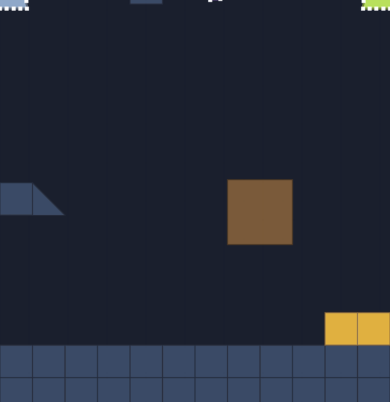

# 🍮 Soft bodies

⚡ **A blob is a ring of dots for a skin, a heavy dot in the middle for its insides, and three kinds of rule holding them together.**



## 🧠 How it works

- 👉 **edges** join each skin dot to the next: stiff, so the skin doesn't tear
- 👉 **spokes** join every skin dot to the **core**: soft, so it can squash but remembers its shape
- 👉 an **area** rule keeps the volume: squash it down and it bulges out sideways 🫓

<details>
<summary>🤓 the details</summary>

```
        ●───●───●            ● skin particle (the ring)
      ●  \  |  /  ●          ─ edge: stiff, ring neighbours
     ●  ─── ◉ ───  ●         \ spoke: soft, skin to core
     ●───●───●───●───●       ◉ the core, 34× heavier
```

The blobs in the demo are made by `SoftBody.semiDisc`: a dome over a flat base, like a slime.

```kotlin
SoftBody.semiDisc(
    radius = 13.3f,
    arcSegments = 14,      // dots over the dome
    baseSegments = 8,      // dots along the flat bottom
    coreMass = 34f,        // the core is 34× a skin dot
    heightScale = 1.3f,    // a bit taller than a half circle
)
```

That's **22 skin dots + 1 core = 23 particles**. Five blobs = the 115 in the HUD. ✅

🪨 **Why a heavy core?** It *is* the goo inside. When the skin gets stuck on an edge, say the
rim of a gap, the core's weight drags the whole body through. That's how the slime in
[slimy-the-blob](https://github.com/pererikbergman/slimy-the-blob) squeezes through gaps narrower
than itself.

The particles are stored as plain `FloatArray`s inside `SoftBody`. You read them with
`positionX(i)` / `positionY(i)`: `0 until ringCount` is the skin, in order, and `ringCount` is the core.

</details>

## 🎛️ The knobs

| knob | default (demo) | turn it up 🔼 | turn it down 🔽 |
|---|---|---|---|
| `coreMass` | `34` | sags, slumps, punches through gaps 🪨 | floaty, springy, gets stuck on edges 🎈 |
| `radius` | `13.3` | a bigger blob | a smaller blob |
| `arcSegments`, `baseSegments` | `14`, `8` | smoother skin, more to compute | blockier, cheaper |
| `heightScale` | `1.3` | a taller dome | flatter |
| `SoftBodyTuning` | see [🧮 XPBD](xpbd.md) | | |

## 💥 Gotchas

- 💥 **Corner snag.** A skin dot can catch on a stair corner while the rest moves on, and one edge
  stretches to 4× for a single step. It snaps back the next step. SceneTest allows half a second of
  over-stretch before it calls it a tear.
- 💥 **A light core can't drag.** The light-core blob bounces around nicely but would get stuck in a
  narrow gap: nothing heavy pulls it through.
- 💥 **The core lags on hard landings.** With soft spokes it can poke a few units out of the skin for
  a few steps. That's fine. Staying out for half a second means it went through a wall without
  its skin, and SceneTest fails on it.

## 🧪 Try it

`./gradlew :demo:run`, scene `1` **Blob Garden**, `F1` for the dots. The red dot is the core. Compare
the 💜 heavy core and the 💚 light core when they land.

📸 `scripts/capture.sh 1 soft-bodies --from 0.3 --to 1.5 --details --clean --slow --crop 0.45,0.45,0.3,0.55`
