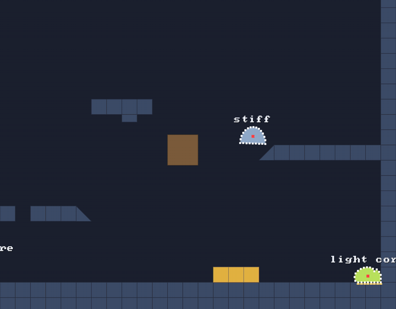

# 🧱 Solids

⚡ **The level is a grid of tiles. A particle inside one gets pushed out the shortest way that actually leads to air.**

## 🧠 How it works

- 👉 a particle is a point, so it can only be in **one tile**. check that one, plus anything moving 🏎️
- 👉 push it out through the **nearest face**, but never through a face that's **buried** against another tile, or the edge of the world
- 👉 keep the speed **along** the surface, drop the speed **into** it, so things slide

🤓 the details

**The shapes** (`SolidShape`), all made with `SolidGrid.fill(col, row, shape)`:

| | shape | the way out |
|---|---|---|
| ⬛ | `BOX` | the nearest open face, or an open corner |
| ◢ | `RISING` | the surface (diagonally up and left), or the open bottom or right side |
| ◣ | `FALLING` | the mirror image |
| ▀ | `fillTopHalf` | a stub hanging from a ceiling |
| 🟫 | `Solid.moving(...)` | a box with no grid cell, such as the crusher. checked for every particle |

**Buried faces** 🪦: a floor made of 40 tiles has 39 seams. Without this rule, a particle that
sinks into the floor near a seam gets pushed *sideways* into the next tile, and the blob judders.
So a face that's covered by its neighbour is never a way out.

**Open corners** 🔲: where a stair step meets a wall, the wall tile's top *and* left faces are
both buried, but the cell diagonally across that corner is air. A point just inside leaves
through the corner, at the straight-line distance. A corner is never closer than an open face
beside it, so it only ever wins there.

**Sliding** 🛝: `SoftBody.pushOut` moves the particle out along the normal, then keeps only the
part of its velocity that isn't going into the surface. That's friction-free sliding, for free.

## 🎛️ The knobs

| knob | default | what it does |
|---|---|---|
| `SolidGrid(cols, rows, tileSize)` | `16` units a tile in the demo | the grid. one solid per cell, max |
| `fill(col, row, shape, tag)` | `BOX`, tag `0` | puts a solid in a cell |
| `dynamic` | empty | solids that move. move them by setting `top` and `bottom` |
| `SoftBodyTuning.maxStep` | `4` | keep it **under half the thinnest wall**, or a fast particle can pop out the far side |

## 💥 Gotchas

These all bit us. 🫠

- 💥 **The edge of the world.** A wall tile at the grid's edge had its outer face as the nearest
  way out, so a blob in the wall-floor corner got pushed out of the world. Now the grid's edge is
  never an exit.
- 💥 **Slopes in mid-air.** A slope used to push everything up through its surface, even a blob
  hitting it from *below*, which got yanked through onto the top and stretched to 4.6×. Now the
  open bottom and the tall side are ways out too.
- 💥 **The step-and-wall corner.** A blob's core, nudged half a unit into the corner where a stair
  meets a wall, got shoved 16 units *through* the wall, out under the deck. Its skin stayed on top.
  Fixed with open corners.
- 💥 **Halfway is the point of no return.** Past the middle of a one-tile platform, the far face is
  closer than the one you came in through. That's what `maxStep` and [🔁 substeps](substeps.md)
  are for: nothing should ever get that deep.

## 🧪 Try it

`./gradlew :demo:run`, scene `1` **Blob Garden**, `F1` for details. Ramps and stairs on the left,
the floating ledge with its slope on the right, and the 🟫 crusher in the middle.

📸 `scripts/capture.sh 1 solids --from 3.5 --to 7.5 --details --clean --crop 0.35,0.1,0.65,0.9`
