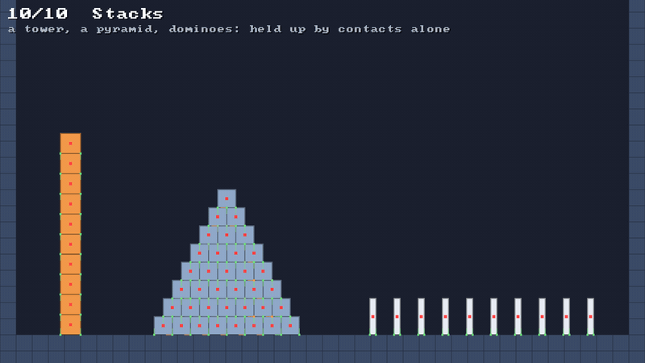

# 🧱 Stacking: contacts, friction, bounce

⚡ **Push overlapping bodies apart at their contact points, hold them in place sideways while friction can, and give back the bounce afterwards.**



## 🧠 How it works

- 👉 every substep, find each point where two shapes **touch** ([✂️ SAT](sat.md)) or meet a **wall**, and **push** them apart there, split by how hard each is to move 💪
- 👉 while the push along the surface needed to stop a slide is under the **static friction** times the push holding them on, **hold** them where they first touched 🧲
- 👉 after the substep, take off **sliding speed** for dynamic friction, and set the speed **out** of the surface for the **bounce** 🏀

<details>
<summary>🤓 the details</summary>

```kotlin
val world = PhysicsWorld()
world.solids = room
val box = world.rigidBody(Shape.box(20f, 20f), 300f, 100f, material = Material.RUBBER)
world.step(1f / 60f)

val contacts = world.rigidContacts
for (c in 0 until contacts.count) {
    contacts.pointX(c); contacts.pointY(c)    // where, on the first body
    contacts.normalX(c); contacts.normalY(c)  // the way the first is pushed back from
    contacts.push(c)                          // how hard: 0 for one found near that didn't touch
    contacts.isSliding(c)                     // friction couldn't hold it
    contacts.bodyB(c)                         // -1 against the solids
}
```

**Positions first, as in Müller 2020.** A contact is two points, one on each body, and a normal.
Each pass of the solver measures how far they overlap along the normal and moves both bodies apart
by that much, each by how easy it is to move at that point: a heavy body moves less, and a point far
from a body's middle turns it more than it moves it. The push is remembered, because it's what
friction is measured against.

**Two points are solved together.** A box resting on a box touches at two corners. Pushed one
after the other, the first push tips the box a little, the second tips it back a little less, and
every box in a tower leans the same way. So the two points of one contact are solved at once, as a
2 × 2 problem: the pushes that leave neither overlapping, with neither pulling.

```
   ┌──────────┐
   │          │      push at ● and ● together:
   │          │      the box goes straight up,
   └●────────●┘      it doesn't rock
  ┌───────────────┐
```

**Friction holds where it first touched.** Each contact remembers where its two points were when
they first met, its **anchors**, and keeps that from one substep to the next by matching its bodies
and the edge and corner that made it ([✂️ feature ids](sat.md)). Static friction pulls the points
back to their anchors sideways, as long as that takes less than the static friction times the push.
Measuring from the anchors, and not from where the points were at the start of each substep, is what
keeps a pyramid from creeping: tiny slips that don't add up.

**Friction after the push.** In each pass, a contact is pushed apart first and held sideways
second, so the last thing done to it is to stop the slide.

**Speeds after the substep.** Positions say where the bodies are, and their velocities follow from
how far they moved. Then a velocity pass fixes those up: a contact that was hitting at more than
`bounceSpeed` leaves at its restitution times the speed it came in with; slow ones only stop going
in. Sliding speed is taken off, at most the dynamic friction times the push. It runs as many
passes as the solver does.

**Walls are edges, not tiles.** A row of floor tiles is one long edge, so a box sliding along it
never catches on the seams between them. Each edge is one-sided, pushing only out of the solid, and
reaches a little past its ends where it meets another edge inside a corner, so nothing slips into
the crack. Moving solids are bodies like any other.

**Each body's materials meet** as for particles ([🧽 friction](friction.md)): friction is the
geometric mean of the two, restitution the larger.

</details>

## 🎛️ The knobs

| knob | default | turn it up 🔼 | turn it down 🔽 |
|---|---|---|---|
| `Material.staticFriction` | `0.6` | holds on steeper slopes: rubber, `1.2`, holds a slab on 45° | slides sooner: ice is `0` |
| `Material.friction` | `0.4` | a slide stops sooner | a slide goes on: `0` on ice keeps every bit of speed |
| `Material.restitution` | `0` | bounces higher: a ball back up to `e²` of its drop | stops dead |
| `PhysicsConfig.bounceSpeed` | `40` | slow hits stop dead instead of jittering | even slow hits bounce |
| `PhysicsConfig.substeps` | `4` | taller stacks stand stiffer | cheaper, a tall tower sags and wobbles |
| `PhysicsConfig.iterations` | `6` | contacts settle closer each substep | cheaper, softer |

## 💥 Gotchas

- 💥 **Tall towers leaned.** Every box tipped the same way, since its two corners were pushed one
  after the other. Two points are solved together now.
- 💥 **Towers rocked.** The velocity pass set one corner's speed at a time and the other corner paid.
  A resting single point now only stops going in, and a pair is set together.
- 💥 **Pyramids crept.** Friction held each substep's slip at zero, but measured each time from where
  the points had ended up, so a hair of slip a substep walked the whole pyramid sideways. Anchors
  that carry over fixed it.
- 💥 **A square box on a 45° slope** is exactly on its tipping point: whether it tips or holds is up
  to rounding. Test friction with a slab, lying low.
- 💥 **Corners in the floor.** A point more than 8 units behind an edge counts as having come through
  from the solid's far side, and is left alone. A triangle landing hard on its point got that deep in
  one substep and sank. Now a point that was nearer at the start of the substep is pushed back out.
- 💥 **A kinematic platform starts instantly.** A box on one that starts at full speed slips until
  friction has caught it up: about a unit at 40 units a second. Ramp the platform up if that shows.

## 🧪 Try it

`./gradlew :demo:run`, press `0` for **Stacks**, then `F1` three times to see every contact: the
tower and the pyramid stand, the dominoes fall one by one. Right click to drop a box on them. 🎯

📸 `scripts/capture.sh 10 stacking --from 0.5 --to 4 --view 3 --clean`
