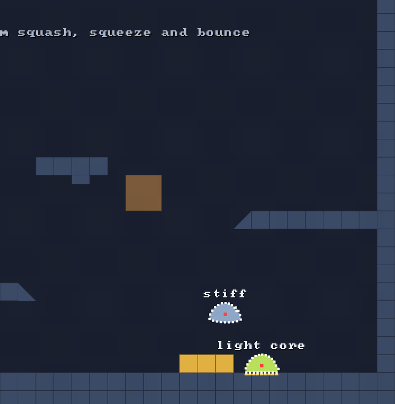

# 🔁 Substeps

⚡ **Don't take one big step per frame. Take four small ones. Everything gets stiffer, steadier and harder to tunnel through.**



## 🧠 How it works

- 👉 the game ticks 60 times a second. each tick is cut into **4 substeps** of 1/240 s
- 👉 each substep: move every particle once, then **6 passes** of "fix the constraints, push out of walls"
- 👉 small steps mean small moves, so particles **can't skip through** a wall, and soft things stay as soft as you tuned them

<details>
<summary>🤓 the details</summary>

One fixed step, from `PhysicsWorld.step`:

```kotlin
val h = dt / config.substeps                // 1/60 s / 4 = 1/240 s
events.beginStep()                          // 🦶 last step's floors become "before"
repeat(config.substeps) {
    integrate(h, keep)                      // 🏃 every particle moves once
    constraints.beginSubstep()              // forget last substep's pushes (λ)
    repeat(config.iterations) { pass ->     // 6 times:
        constraints.solve(h)                //   🧮 pull every constraint toward rest
        if (pass == last) particles.applyFriction()   // 🧽 grip, once, before the last pass
        collisions.solve()                  //   💥 push bodies out of each other
        solids?.collide(particles, events)  //   🧱 push out of the solids: walls get the last word
    }
}
```

**Why substeps beat more iterations:** an iteration only fixes constraints *again*, with the same
big move behind it. A substep makes the move itself smaller. The error in XPBD shrinks with `h²`,
so halving the step cuts it by four. ✂️

**Tunnelling, in numbers.** A blob off a bounce pad goes 680 units/s. In one 1/60 s step that's
**11 units**, most of a 16-unit tile. In a 1/240 s substep it's **2.8 units**. No skipping. 🧱

That's `4 × 6 = 24` passes over every constraint per tick. Each one is cheap. 🏎️

</details>

## 🎛️ The knobs

| knob | default | turn it up 🔼 | turn it down 🔽 |
|---|---|---|---|
| `PhysicsConfig.substeps` | `4` | stiffer, steadier, no tunnelling, costs more | cheaper, but bodies go soft and fast ones tunnel 👻 |
| `PhysicsConfig.iterations` | `6` | stiff constraints get closer to rigid | cheaper, things sag a bit |
| klyph's `fixedRate` | `60` | same as more substeps | same as fewer |

## 💥 Gotchas

- 💥 **More substeps cost more.** Every substep runs every pass over every constraint and every
  particle against the solids. Double them and the step takes twice as long.
- 💥 **Iterations aren't free stiffness.** Past a handful, more passes barely help. If a body
  is too soft, add a substep or lower its compliance.
- 💥 **`maxStep` must stay under half the thinnest wall.** Substeps make moves small, and
  `maxStep` makes sure of it, so a particle never jumps past a wall's middle.

## 🧪 Try it

`./gradlew :demo:run`, scene `1` **Blob Garden**. Watch the blob that lands on the yellow pads
🟨: it goes up at 680 units/s and never ends up inside the ceiling. `S` slows it to ¼ speed.

📸 `scripts/capture.sh 1 substeps --from 7 --to 9 --view 1 --clean --crop 0.45,0,0.55,1`
