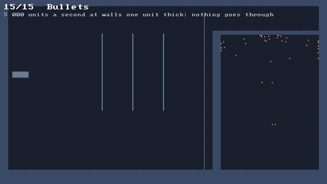

# 🚀 Fast things and tunnelling

⚡ **Something fast can be on one side of a wall in one substep and on the other in the next. Bullets are swept along the way they went, so they stop at the wall.**



## 🧠 How it works

- 👉 everything is held to `maxStep` a substep, 960 units a second by default: slow enough that walls catch it 🐢
- 👉 a **bullet** isn't held back: after each move it's **swept** from where it was to where it went, in steps thinner than itself, and put back where it first touched 🎯
- 👉 fast bodies that aren't bullets get **speculative** contacts: found where they were at the start of the substep, so the push points back the way they came 🔮

<details>
<summary>🤓 the details</summary>

```kotlin
val bullet = world.rigidBody(Shape.circle(3f), x, y)
world.rigidBodies.setBullet(bullet, true)
world.rigidBodies.setVelocity(bullet, 5000f, 0f)

val spark = world.particles.add(x, y, radius = 1f)
world.particles.setBullet(spark, true)
world.setVelocity(spark, 0f, -5000f)
```

**Tunnelling.** A body is moved, then looked at. If it moves further in one substep than the wall
is thick, it can be in front of the wall in one look and behind it in the next, without ever being
seen inside it. Even half way in is too far, because the shortest way out is then through the far
side.

```
  substep 1        substep 2           substep 2, swept
   ●    ┃              ┃    ●              ●┃
        ┃              ┃                    ┃
   never touched: it passed            stopped where it first touched
```

**`maxStep`** is the first line of defence: nothing moves more than 4 units a substep, half of the
thinnest solid, a half tile, so particles never pass through the solids. At 60 steps of 4
substeps, that's 960 units a second, quick enough for most things.

**A bullet is swept.** A bullet goes as fast as it's thrown. After the substep's move it's walked
from where it was to where it went in steps of half its own thickness, so it can't step over even a
wall of no thickness at all: at some step it overlaps it. At the first step where it overlaps
something, the step and the one before are halved eight times, to find where it first touched, and
the bullet is put there, a sliver in. Its velocity is kept, so the contact found there stops it, or
bounces it off, at the speed it came in.

**What it was already touching** counts too, but only once the bullet has gone a contact's margin
deeper into it than it started. So a bullet rolls along a floor without stopping every substep, but
one that hit a wall and is pivoting on its corner can't swing the rest of itself through.

**Particles** are swept against the solids, in quarter-tile steps, and put back where they first
reach into one, with their whole velocity.

**Speculative contacts.** A fast body that isn't a bullet moves up to `maxStep` a substep. A small
ball doing that into a one-unit wall is half through it in one substep, and pushed out the far side.
So when two bodies have moved more than the contact margin, and more than half the thinner of the
two, far enough to be past its middle, their contact is found where they were at the start of the
substep, as far apart as they've moved. The normal then points back the way
they came, and the solver pushes them back along it from where they are now. A body that turned
more than 0.2 radians in the substep is looked at where it is: the points that were nearest at the
start aren't the ones touching now.

</details>

## 🎛️ The knobs

| knob | default | turn it up 🔼 | turn it down 🔽 |
|---|---|---|---|
| `RigidBodies.setBullet` | off | as fast as thrown, swept every substep: a few shape tests each | held to `maxStep` |
| `Particles.setBullet` | off | as fast as thrown, swept against the solids | held to `maxStep` |
| `PhysicsConfig.maxStep` | `4` | faster things, but over half a tile and particles pass the solids | slower, safer |

## 💥 Gotchas

- 💥 **A test bullet "went through" the wall: it went round it.** A bullet that glances off a
  wall slides along it, off its end, and round the back. The test's wall is now long enough that
  nothing gets round it in time.
- 💥 **A spinning bullet swung through.** Stopped at the wall, a little box spun up to 400 radians a
  second and pivoted on its corner. The wall was left out of its sweep, since it was already touching
  it, and the contact from the start of the substep held a corner that was no longer the one in the
  wall. Walls it's touching now count once it's deeper than it was, and a body that turned far gets
  no speculative contact.
- 💥 **Speculative contacts wound up the Newton's cradle.** Used for every pair that moved more than
  the margin, they let a cradle ball swing right over its pivot. Two balls meeting head on kept their
  energy exactly, so it took the rods and gravity together, and we haven't found how. They're only
  used now where a body could get past the middle of the other: the cradle's balls are 24 thick and
  never are.
- 💥 **Sparks off a ceiling skid.** A particle that hits flat at 5 000 units a second and stops still
  keeps its sideways speed, and goes a long way. The demo's sparks have a bin.
- 💥 **Bullets aren't swept against particles or soft bodies,** and a particle bullet only against
  the solids, not against rigid bodies. Moving solids aren't swept for a rigid bullet either.

## 🧪 Try it

`./gradlew :demo:run`, press `→` until **Bullets** ([`Bullets.kt`](../../demo/src/nativeMain/kotlin/klyph/physics/demo/Bullets.kt)), and `Space` then `.` to step a frame at a time: a bullet
crosses the room in four frames. Right click to fire one at the mouse. 🎯

📸 `scripts/capture.sh 15 bullets --from 0.3 --to 3.3 --slow --clean --width 640`
