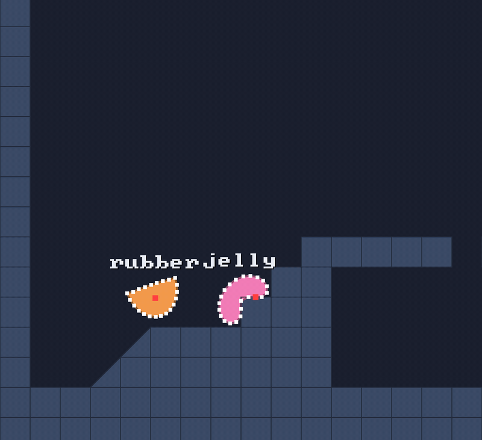

# 🏃 Verlet integration

⚡ **A particle doesn't store its speed. Its speed is just *where it was a moment ago*.**



## 🧠 How it works

- 👉 every particle keeps **two positions**: where it is now, and where it was one substep ago
- 👉 to move, it repeats its last move: `next = now + (now - before)`, plus a little gravity
- 👉 to change its speed, you change **where it was**, not where it is

<details>
<summary>🤓 the details</summary>

One move, from `PhysicsWorld.integrate`:

```kotlin
var dx = (x - prevX) * keep                       // the last move, a tiny bit weaker
var dy = (y - prevY) * keep + gravity * h * h     // plus gravity, h = the substep's length
// cap the move at maxStep, then:
prevX = x; prevY = y                              // now becomes before
x += dx; y += dy                                  // and the particle moves on
```

**Why bother?** Because constraints and collisions just **move particles**, and the velocity
updates itself: push a particle out of the floor and its "where I was" stays behind, so it
automatically gets the speed that push implies. No velocity bookkeeping, no blow-ups. 💪

The engine still edits velocity on purpose, by moving the *previous* position:

| call | does |
|---|---|
| `world.setVelocity(p, vx, vy)` | `prev = now - v * h`: a jump, whatever it was doing before |
| `particles.moveTo(p, x, y)` | moves now **and** before, so it keeps its speed and doesn't launch |
| walls (inside the step) | move it out of a wall **and** keep only the speed along the wall |
| `particles.movedX(p)` | `x - prevX`: the velocity, in units per **substep** |
| `world.velocityX(p)` | the same, in units per **second** |

</details>

## 🎛️ The knobs

| knob | default | turn it up 🔼 | turn it down 🔽 |
|---|---|---|---|
| `PhysicsConfig.damping` | `0.24` per second | slower, like moving through honey 🍯 | `0` keeps all the speed: bouncy forever |
| `PhysicsConfig.maxStep` | `4` units | faster things allowed, but they can tunnel 👻 | a speed limit: `maxStep / h` = 960 units/s at 240 substeps a second |
| `PhysicsConfig.gravity` | `Vec(0, 1500)` | heavier world | the moon 🌙 |

## 💥 Gotchas

- 💥 **Teleporting launches things.** Move a particle without moving its previous position and
  the jump *is* its velocity: next substep it flies off. Use `particles.moveTo` or
  `softBodies.placeAt`, which move both.
- 💥 **Damping is per second**, not per substep: `0.24` keeps `e^-0.24 ≈ 79%` of the speed each
  second, however many substeps you take. (It used to be per substep, so more substeps meant more
  damping. Not any more.)
- 💥 **`movedX` isn't units per second.** It's units per substep. Divide by `h`, or use `velocityX`.

## 🧪 Try it

`./gradlew :demo:run`, scene `1` **Blob Garden**, press `F1` to see the particles and `S` for
slow motion. Then `Space` and `.` to step through a hop one step at a time. 🐢

📸 `scripts/capture.sh 1 verlet --from 2.8 --to 4.2 --view 1 --clean --slow --crop 0,0.35,0.4,0.65`
