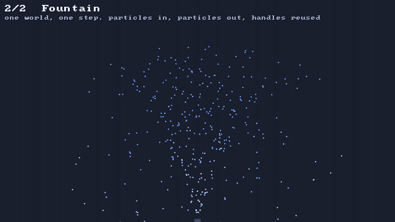

# 🌍 The world and one step

⚡ **One `PhysicsWorld` owns everything that moves. You call `step(dt)` once per tick. That's the whole API for time.**



## 🧠 How it works

- 👉 the world keeps every particle in **plain arrays**: x, y, where it was, mass, radius, flags. a particle is just an **`Int`**
- 👉 `step(dt)` cuts the tick into **substeps**. each one moves everything, then fixes the rules and the collisions
- 👉 no objects get made during a step. **zero allocations**, so no garbage collector hiccups 🗑️🚫

<details>
<summary>🤓 the details</summary>

```kotlin
val world = PhysicsWorld(PhysicsConfig(gravity = Vec(0f, 1500f), substeps = 4))

val p = world.particles.add(x = 100f, y = 50f, mass = 1f, radius = 2f)   // 👈 p is an Int
world.setVelocity(p, vx = 300f, vy = -600f)

world.step(1f / 60f)                                                     // ⏱️ once per tick
println(world.particles.x(p))
world.particles.remove(p)                                                // 👋 p may come back as a new particle
```

**One step:**

```
step(dt):
  repeat substeps (h = dt / substeps):
    🏃 integrate: every particle repeats its last move, plus gravity
    🧮 repeat iterations: solve the constraints, then collide       ← #10 and on
```

**Handles get reused** ♻️. Remove particle 7 and the next `add` hands out 7 again, so the arrays
stop growing once things balance out. The fountain adds 360 particles a second, forever, and its
store stops growing after a second and a half.

**Growing by doubling** 📈: when the arrays are full, `add` makes them twice as big. That's the
only place memory is allocated, and it never happens inside `step`.

**Same in, same out** 🎯: two worlds fed the same calls in the same order end up with the same bits.
The tests check it.

**Zero allocations, checked** ✅: the engine also builds for the JVM, just so a test can read how
many bytes a thread allocated. 10 000 steps of 500 particles: under 1 KB in total, and a single
planted allocation shows up as 240 000 bytes.

</details>

## 🎛️ The knobs

All in `PhysicsConfig`:

| knob | default | turn it up 🔼 | turn it down 🔽 |
|---|---|---|---|
| `gravity` | `Vec(0, 1500)` | heavier world. y grows down, so down is positive | the moon 🌙 |
| `substeps` | `4` | stiffer, steadier, costs more | cheaper, softer, fast things tunnel |
| `iterations` | `6` | stiff rules get closer to rigid | cheaper, things sag |
| `damping` | `0.24` per second | things slow down sooner, like air is thicker | `0` keeps all the speed forever |
| `maxStep` | `4` units | faster things allowed, but they can tunnel 👻 | a speed limit |

## 💥 Gotchas

- 💥 **A removed handle comes back.** Keep a particle's handle only while it's alive. After
  `remove`, the same number may be a brand-new particle.
- 💥 **Damping is per second now.** In the old soft body it was per substep, so adding substeps
  made things more damped (see [🏃 Verlet](verlet.md)). In the world it's `exp(-damping · h)` per
  substep, the same per second however you step it.
- 💥 **`maxStep` is still per substep**, on purpose: it protects against tunnelling through walls,
  and walls don't get thicker when you add substeps.
- 💥 **Velocity is measured over the last substep.** `velocityX(p)` divides by the last `dt / substeps`.
  Change `dt` between steps and it's measured against the old one.

## 🧪 Try it

`./gradlew :demo:run`, press `2` for **Fountain**. The HUD's `particles` count goes up, then holds:
every particle that falls out of sight hands its handle to a new one. ♻️

📸 `scripts/capture.sh 2 fountain --from 1 --to 4 --clean`
