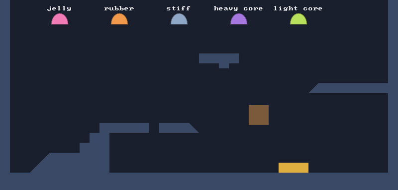

# 🧮 XPBD and compliance

⚡ **Every rule ("stay this long", "keep this area") is a constraint, and its softness is a real number: how far it gives per unit of force. Not "how many times we tried".**



## 🧠 How it works

- 👉 a **constraint** is a number that should be zero: `length - rest`, `area - restArea`
- 👉 each pass nudges the particles to shrink it, as far as its **compliance** allows. `0` = rigid
- 👉 every constraint remembers how hard it has pushed this substep (its **λ**), so softness doesn't depend on how many passes you run

<details>
<summary>🤓 the details</summary>

**PBD**, the old way: move the particles all the way to fix the constraint, times a "stiffness"
between 0 and 1. Problem: run more passes and things get stiffer. Your jelly turns to rubber
because you added an iteration. 😬

**XPBD** (*extended* PBD) fixes that. From `SoftBody.pull`, for a distance constraint:

```kotlin
val softness = compliance / (h * h)                       // α̃: compliance, scaled to the substep
val error = length - rest                                 // C: how wrong it is
val change = (-error - softness * lambda) / (wa + wb + softness)
lambda += change                                          // λ: the push so far this substep
a += wa * change * direction                              // light particles move more 🪶
b -= wb * change * direction                              // heavy ones move less 🪨
```

- `wa`, `wb` are **inverse masses**. The core is 34× heavier, so its `w` is 1/34 and it barely moves.
- `softness * lambda` is the magic bit 🪄: the more it has pushed already, the less it adds. It settles
  on the push a spring of that compliance would make, however many passes you run.
- λ resets every substep, in `integrate`.

The area constraint works the same, with the gradient of the area instead of a direction:
squash the body in one place and every outline particle gets pushed outward a bit.

</details>

## 🎛️ The knobs

All in `SoftBodyTuning`. Smaller = stiffer. They're tiny numbers because they're in real units.

| knob | default | turn it up 🔼 | turn it down 🔽 |
|---|---|---|---|
| `edgeCompliance` | `0.00002` | the skin stretches and **tears** 💥 | a skin that doesn't stretch. `0` is fine |
| `spokeCompliance` | `0.0005` | squishier, wobblier, forgets its shape 🍮 | bouncier, holds its dome shape 🏀 |
| `areaCompliance` | `0.0004` | sags and squeezes flat 🫠 | keeps its volume like a water balloon 🎈 |

The five blobs in the garden:

| blob | edge | spoke | area | core |
|---|---|---|---|---|
| 🩷 jelly | default | `0.004` | `0.003` | 34 |
| 🧡 rubber | default | `0.0001` | `0.0001` | 34, and `damping = 0.9995` |
| 🩵 stiff | `0` | `0.00001` | `0.00001` | 34 |
| 💜 heavy core | default | default | default | **80** |
| 💚 light core | default | default | default | **5** |

## 💥 Gotchas

- 💥 **Soft edges tear.** We tried a jelly with soft edges too. Its skin stretched to 3× on the first
  landing. Keep the *edges* stiff and make the *spokes and area* soft.
- 💥 **`0` isn't perfectly rigid.** Six passes get close, not all the way. For stiffer, add a substep
  (see [🔁 Substeps](substeps.md)).
- 💥 **Compliance depends on the units.** It's per unit of force in *your* world units. Change the tile
  size or gravity a lot and re-tune.

## 🧪 Try it

`./gradlew :demo:run`, scene `1` **Blob Garden**. Same shape, five tunings: watch the jelly flop and
the stiff one stay a dome. `R` to drop them again.

📸 `scripts/capture.sh 1 xpbd --from 0 --to 3 --clean --crop 0,0.15,1,0.85`
